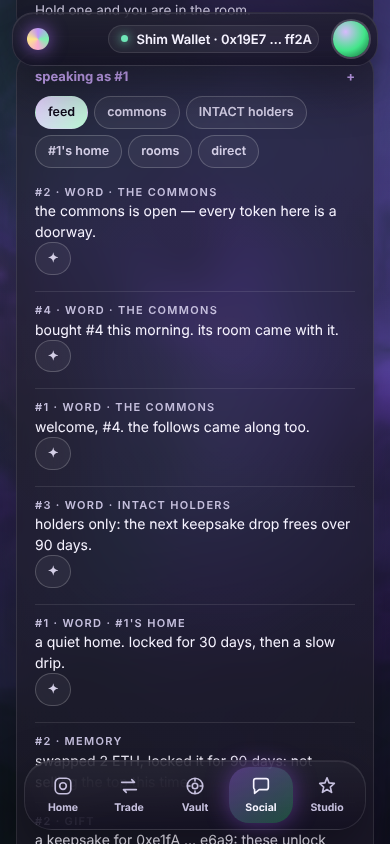
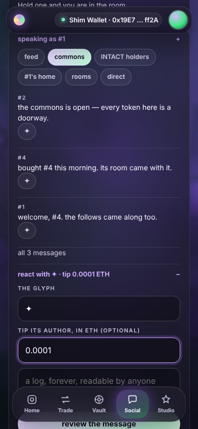
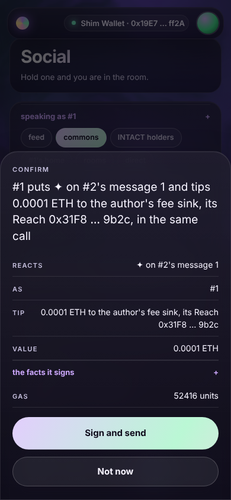
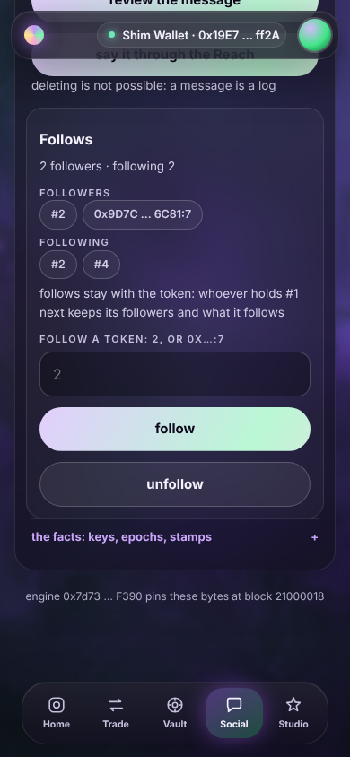
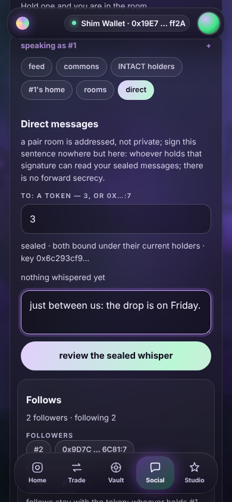
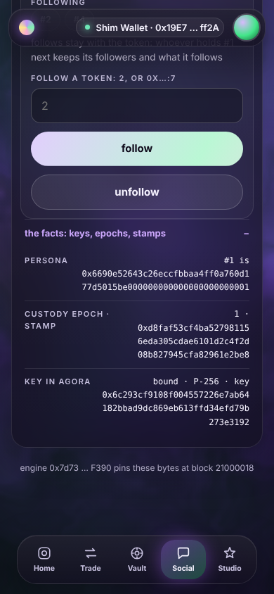
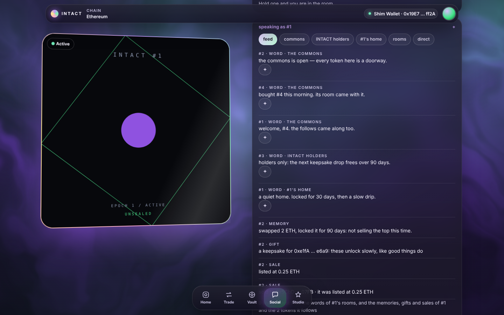

# W11 · the Social lane, speaking Agora

V2 wave 2, unit W11 (`docs/V2.md` §0 rows 8–9, §3.5, §5). The owner asked
to "embed chat and a simple, powerful social layer", and for "extraordinary
network effects". Agora (W5) is that layer on chain; this unit is the lane a
person uses it through: `engine/panels/social.js`, its DOM-shim group
`tools/verify-site/social.mjs`, the social group of
`tools/verify-console.mjs`, and the screenshots `docs/v2/shots/social-*.png`.
Built on 2f17d92, 2026-10-19. Every number below was measured on this tree
and names the run that printed it.

## 1. What the lane does

**One lane, two backends.** A band whose state block does not report Agora
keeps exactly the V1 lane — Parley's rooms, the Roster's followers,
Postage's inbox and stamps — and every V1 sentence passes unchanged. Where
`S.reported & S.bits.agora`, the same code speaks Agora. Agora's rows have
Parley's signatures, its `Said` has Parley's shape, and its room keys are
Parley's formulas with personas (`collection << 96 | id`) in place of token
ids, so the walk, the composer, the groups and the sealing flow are shared:
only the contract (`AT`), the row word (`K`) and the speaker change.

**The speaker** is this token's persona, `persona(hub, id)` — or any other
token the connected wallet holds, typed under *speak as* (`2`, or
`0x<collection>:<id>` for a token of any ERC-721). One identity, every room:
a holder of an Ape can open an INTACT token's page and speak, follow and
react there as the Ape. The line *speaking as #1* names the speaker; the
field is behind it, one tap away.

**The rooms**, one tap away as chips: *feed*, *commons*, *&lt;collection&gt;
holders*, *#1's home*, *rooms*, *direct*.

- **The commons** hears registered collections only (this hub and what the
  Studio launched, read live through `studio.isCollection`, as Agora reads
  it). A speaker of any other collection is told so in words before any
  slab: *the commons hears registered collections only, this hub's and the
  Studio's: 0x1234 … abcd:7 is of neither, and speaks in its own
  collection's room* (a token of another collection is named by its
  collection's shortened checksummed address and its id).
- **The collection room** is `collectionKey` of the speaker's collection —
  *INTACT holders* for this hub's tokens, *0x1234 … abcd holders* for the
  Ape — so a collection from anywhere has a room on chain, opened by its
  first word.
- **The home** is `homeKey(persona)`. Its steward speaks by right; anyone
  else takes a seat first (*take a seat in #1's home*).
- **Groups** are V1's rooms screen on personas: found, join, leave, invite.
- **Direct messages** are V1's sealing flow between personas. Keys are bound
  through Agora's `bindKey`, offered right there (*bind this wallet's key to
  #1*); the recipient's key is re-read when the slab is built and again
  inside the press, exactly as in V1. Agora has no Postage, so a whisper is
  admitted and free and there is no inbox or stamp under Agora.

Every room is walked as the Parley lane walks: `stateOf(room).last`, then one
single-block `eth_getLogs` per hop with the topics the state block carries
(`said`, which is Agora's `topics()[0]` — the Catalog serves Agora's
signatures). A refused query is the sentence *eth_getLogs refused; the walk
cannot start: …*.

**Follow.** The follow box shows *N followers · following M*, the
followers and the followed as chips, and says plainly: *follows stay with
the token: whoever holds #1 next keeps its followers and what it follows*.
Speaking as another token, the page offers *follow #1* / *unfollow #1*; a
field takes any token (`2`, or `0x…:7`) with *follow* and *unfollow*. The
counts are folded from Agora's `Followed` logs (decision 6).

**React.** Every word carries a ✦. The glyph (any one to four bytes of
UTF-8) and an optional tip in ETH wait behind a line that says what a ✦
does now — *react with ✦ · no tip*, *react with ✦ · tip 0.0001 ETH*. The
author is the one the `Said` log names, never typed, and the slab names
the payee as Agora pays it: *#1 puts ✦ on #2's message 1 and tips 0.0001
ETH to the author's fee sink, its Reach 0x31F8 … 9b2c, in the same call*
(*its Grip* when the holder chose so; *its holder* for a token of another
collection).

**The feed** — the default tab — joins, client-side and by the order the
chain wrote them (block, then log index), the words of the rooms this
token is in (the commons, its collection's room, its home, every group it
holds a seat in) with the Journal's memories (`Inscribed`), the Keepsake's
gifts (`Wrapped` from a followed token's Reach to someone else) and the
sales (the Bazaar's `Published`, and Seaport's `OrderFulfilled` joined by
order hash) of the tokens it follows and of itself. Each line is a post
with its kind marked: *#2 · word · the commons*, *#2 · memory*, *#2 ·
gift*, *#2 · sale*. A source not deployed, not read, or whose range the
endpoint refused is a sentence (*memories: the range was refused (…)*) and
never shown as none. Its composer speaks in the commons: one feed, one
composer.

**The facts**, one tap away and never in the way: the persona word, the
custody epoch and the stamp (`keccak(holder, epoch)`, the key of every
brake, seat, invitation and binding a sale ends), and the key bound in
Agora.

At 390×844 (the cast and the method are in §8):

| The feed | The commons, the ✦ open | A tipped ✦'s slab |
|---|---|---|
|  |  |  |
| **The follows** | **A sealed direct message** | **The facts** |
|  |  |  |

At 1440×900, the feed as it joins memories, gifts and sales:

## 2. Measured

Every number here is from a run on the final tree (2f17d92 plus this
unit's changes), 2026-10-19, on the four shared cores, while four other
units were building beside it.

**The runs the brief names**, each with the last line it printed:

| Run | Last line | Note |
|---|---|---|
| `node tools/verify-site.mjs` | `  645 passed, 0 failed` | 4 m 40 s; 604 on 2f17d92, plus the 41 assertions of the social group's Agora block |
| `node tools/verify-console.mjs` | `  184 passed, 0 failed` | 7 m 15 s, Chromium 141.0.7390.37; 174 on 2f17d92, plus the 10 of the social group's Agora journey |
| `node tools/build-app.mjs` | `  wrote dist/shards.json, dist/manifest.json, dist/app.html, dist/panels/*.js` | its social line: `panel social 12160 bytes gzip 33935 inflated 0x2914a3b64501066c…` |
| `node tools/selftest.mjs` | `  60 passed, 0 failed` | 2.1 s |
| `node tools/verify.mjs` | `  249 passed, 0 failed` | 19.9 s |
| `node tools/static-audit.mjs` | `  static audit passed — 10 Solidity rules, 4 JS rules; this is not a security audit` | 0.4 s |

**Bytes.** The lane is **12,160 B of gzip against the 12,288 ceiling**
(128 B to spare), 33,935 B inflated. V1's panel at 2f17d92 is 8,187 B of
gzip, 22,335 inflated, measured by build-app's own pipeline
(`inlineWhispers`, terser with `shrinkPanel`'s options, zlib level 9) on
2f17d92's `engine/panels/social.js`; the same script reproduces 12,160 for
this tree. The Agora lane costs 3,973 B of gzip.

**The groups.** In the shim battery the social group is 117 assertions
(V1's 76, unchanged and all passing, and 41 in block A); `node
tools/verify-site.mjs --group social` prints `  123 passed, 0 failed`
with the runner's own 6, in 58 s. In Chromium the social group is 28
(V1's 18 and the Agora journey's 10).

**Focus and labels.** Measured in Chromium against the final build by two
scratch scripts on the screenshots' cast. Tabbing forty times through each
of the six tabs and sampling a 5×5 grid over every focused control with
`elementFromPoint`: 188 focuses at 390×844 and 189 at 1440×900, none
hidden and none partly covered — nothing under the dock or the top bar.
At the battery's 1200×900, 188 focuses, every one drawing an outline or a
shadow. With every disclosure open on every tab, 90 controls in Chromium's
accessibility tree (60 buttons, 14 text fields, 16 disclosure summaries),
none without a name. Both runs printed `problems: none`.

**Mutations.** Thirteen one-token mutants of the panel, each rebuilt and
run against the shim's social group: 13 killed, 0 survived on the final
suite (§6, run 2); run 1, before the suite was mended, killed 12.

## 3. Decisions, each with its reason

1. **The backend is chosen by the state block's `agora` bit, by §6.3's
   three-way rule.** Reported: Agora. Absent: the V1 lane, untouched — the
   brief's "a V1 band keeps exactly today's lane". Unread (a V2 state block
   whose probe of Agora failed): the sentence *agora: could not be read at
   block N; Parley does not stand in for it*, and no Parley room in its
   place, because Parley's empty rooms on a V2 band would be printed as this
   chain's conversation. Parley is still deployed on a V2 band and its
   archive stays readable by any tool; the lane does not show it.

2. **The two backends share the code, not a copy of it.** `K` (`parley.` /
   `agora.`), `AT` (the contract), `ME` (the token id / its persona) and
   `AS` (the speaker) are the only differences the shared functions see;
   `walk`, `row`, `composer`, `rooms`, `dm`, the sealing flow, `opener`,
   `keyOf` and the room keys are one copy each. What only V1 has (the
   Roster home, Postage's inbox, stamps and receipts) and what only Agora
   has (tabs, the feed, follows, reactions, the facts) are separate
   functions. The V1 assertions are the proof that the shared code did not
   move V1: the group's 76 that predate this unit pass unchanged (§2).

3. **The speaker can be any token the wallet holds.** V2 §5: "one identity,
   every room" and "every token is a doorway into its community wherever it
   is displayed". A token's page is where a visitor meets it, so the visitor
   must be able to act as its own token there — follow this one, react to
   its words, take a seat in its home — or the doorway leads nowhere. *Speak
   as* is a disclosure whose line names the speaker. Speaking as this token
   needs `HOLD | ACCOUNT` as in V1; speaking as another needs only a
   connected wallet in the console, because the authority is that token's
   collection, which Agora asks (`mayActAs`): a wallet that does not hold it
   sees `would revert: NotYours()` in the slab before the wallet opens. The
   Reach's hand is offered only for this token, whose Reach it is.

4. **The commons' rule is said in words, from the same read Agora makes.**
   `isRegistered` has no row, but its two halves do: the hub is this page's
   hub, and the Studio answers `isCollection` (a V2 row). The lane asks the
   Studio for a speaker of another collection and, on a *no*, prints the
   refusal instead of a composer; on a failed read it offers the composer
   and lets the estimate decide, because a lane that refused on a read it
   did not get would be a lane deciding what the chain did not say.

5. **The collection room follows the speaker's collection.** The brief's
   "this collection's room" is `collectionKey(hub)` for this hub's tokens.
   For an Ape it is the Apes room, which is what an Ape holder can speak in
   (Agora's `NotOfCollection` refuses it anywhere else), so the chip is
   *&lt;collection&gt; holders* and no slab the lane builds can meet that
   refusal.

6. **The follow counts are folded from the `Followed` logs.** No row serves
   `followerCount`, `followingCount` or `follows` (request 3). Agora's
   follows are idempotent — following twice is one edge and one event,
   undoing a missing follow is no event — so each change of an edge is one
   event and its last event is its state; the fold is the counters, and the
   suite holds the lane's numbers to Agora's `followerCount` and
   `followingCount`. It costs two range queries (`[followed, null, p]` and
   `[followed, p]`); a refused range is *the follow graph could not be
   walked on this endpoint: …*, never 0.

7. **A reaction names the author the `Said` log names, and the payee as
   Agora pays it, read when the slab is built.** IAgora: "the viewer checks
   the name against the Said log". The ✦ sits on a row the walk decoded, so
   the author word is the log's topic 2, never typed. The payee sentence
   reads `feeSink(id)` and `account(id)` for a hub author (*its Reach* or
   *its Grip*) and `ownerOf(id)` on the author's collection otherwise (*its
   holder*) — Persona.payeeOf's three cases. The slab carries the tip as its
   value and `spend` only when there is one; the ✦ button is `[data-spend]`
   because it may carry value.

8. **The feed joins by the chain's order, and says what it could not join.**
   Items sort by (block, log index); the newest forty are shown oldest
   first, as every walk in this lane is. Each source (words, memories,
   gifts, sales) is reported, absent, unread or refused on its own, so one
   refusing endpoint costs one kind of line and a sentence, not the feed.
   The words of the token's rooms come from one range query over their
   `Said` logs: the feed has to range anyway (the Journal keeps no
   back-link, W2's report), and each room's own tab still walks single
   blocks.

9. **The feed includes the token's own memories, gifts and sales.** "Of the
   tokens you follow" read literally would make the feed of a token that
   follows nobody empty of itself; a holder looking at its token's feed
   expects its own memories in it. The status line says so: *… the
   memories, gifts and sales of #1 and the 1 token it follows*.

10. **A sale is a listing joined to its fill.** `Published` names the token;
    Seaport's `OrderFulfilled` names only the order and its offerer. The
    lane asks Seaport for the fills of the listings' offerers (topic 1) and
    joins by order hash; an unfiltered `OrderFulfilled` range from block 0
    would be every fill Seaport ever settled, which no public endpoint
    answers.

11. **A gift is a `Wrapped` from a followed token's Reach to someone else.**
    The Reach is where a token's own money lives, so a keepsake it wraps is
    the token's gift; `to == creator` is a keepsake kept, not given. A token
    of another collection has no Reach and gives no gift the lane can name.

12. **A receipt refreshes in place and keeps what is typed.** V1's rule
    (CONSOLE §5). The first cut re-rendered the open tab on every receipt,
    which dropped a half-typed word and the tip field after a reaction
    landed, and left the DM's post-send clear on a detached textarea. The
    lane now re-walks the open room and refreshes the counts, as V1 does;
    the DM re-arms itself after its own receipts (`after`, and `bindKey`'s
    `then`). The suite asserts it (*the receipt refreshes the room in place
    and keeps what is typed: the draft and the tip survive it*) and mutation
    W11 restores the first cut and is killed by it.

13. **The tone is the prototype's: a feed of posts, one composer, the rooms
    as chips, the depth one tap away.** Agora's rows are posts — who and the
    kind over the words, the ✦ under them — where V1's are key/value rows
    (unchanged). *Speak as*, the reaction's glyph and tip, and the facts are
    disclosures whose closed line says the current state. The chips are one
    word each so they sit in two lines at 390 px. *unfollow* is the
    secondary button. One inline style (a row's padding and rule) stands in
    for a `.post` rule `app.css` does not have (request 5).

14. **The stamp is shown, not explained away.** "The keys, epochs and stamps
    are facts one tap away": Persona's stamp is `keccak(abi.encode(holder,
    epoch))`, computed with the shell's keccak from `ownerOf` and the
    custody epoch — the one word whose change silences a seller, empties its
    seats and kills its key.

15. **Bytes.** The lane is 12,160 of 12,288 B gzip (§2). The first complete
    build was 12,105 B; the review fixes (decisions 12 and 13 and the
    offerer-filtered fills) took it to 12,308 B, over the ceiling. Cut:
    the facts' two room-key rows (the room keys are derivable and not in the
    brief's list), the feed's de-duplication of topic sets (a node matches
    any member; duplicates are harmless), one shared sentence for an
    unwalkable follow graph, and tighter wording in Agora-only sentences.
    Tried and reverted: aliasing the six most-called `ui` members as locals
    the minifier could name in one letter grew the gzip from 12,272 to
    12,321 B — the repeated `u.note(` sequences were already cheap
    back-references.

16. **The lane is held by mutations of its own, and an assertion says
    only what its condition checks.** Thirteen one-token mutants of the
    panel, one per guard behind §5's rows (§6), each rebuilt and run
    against the shim's social group. The first run's one survivor (W8, a
    whisper sealed to Parley's address on an Agora band) was not a gap in
    the lane but in the suite: a sentence claimed what only the wait
    before it had checked, and the shim's `until` does not throw. Every
    Agora assertion was then read against its sentence, and the
    envelope's context is now proved outside the page, from the chain,
    because the page's opener is the same code as its sealer and would
    agree with any context the lane got wrong in both places.

## 4. Elements this lane adds

V1's elements are unchanged (CONSOLE §6.2's social row). Under Agora the
lane adds these, and they are listed in the panel's header comment:

| Element | Meaning |
|---|---|
| `#social-as-note` | the line *speaking as #1* (or *not a token yet: 2, or 0x…:7; speaking as #1*); its disclosure holds `#social-as`, the *speak as* field |
| `#social-tabs button.chip[data-tab=feed\|commons\|collection\|home\|rooms\|dm]` | the rooms; `.on` and `aria-pressed="true"` on the open one; the collection chip reads *&lt;collection&gt; holders* |
| `#social-feed .row` (`.who`, `.kind`, `.body`) | the joined feed, oldest first; `.kind` is *word · &lt;room&gt;*, *memory*, *gift* or *sale* |
| `#social-feed-status`, `#social-feed-miss` | what the feed joined (*N lines, oldest first: …*), and every source it could not join |
| `#social-commons`, `#social-collection`, `#social-home-feed` (`.row`, `.who`, `.body`) | the three rooms' walks, each with `#<id>-status` |
| `#social-react` (`#social-glyph`, `#social-tip`) | the reaction's disclosure; its line says what a ✦ does now |
| `#social-follows` | the follow box: `#social-follow-count`, `#social-followers .token`, `#social-following .token`, the sentence that follows stay with the token, and `#social-follow` |
| `#social-facts` | the disclosure: persona, custody epoch · stamp, key in Agora |
| `[data-act=react\|follow\|unfollow\|followThis\|bindKey]` | and `join` for a seat in another token's home |

## 5. Proposed INVARIANTS rows

For `docs/INVARIANTS.md` and DESIGN §14 (the integration's files). They
continue Agora's N rows, since each is Agora's promise as a person meets
it in the console. Every sentence is verbatim in the file named, and every
file runs in the battery (`verify:site`, `verify:console`). Status for all:
**pending (W11)** until the battery runs them on the merged head; each was
seen to fail under the one-token mutation of the panel named (§6).

| Row | Claim | Attacked by | Mutation |
|---|---|---|---|
| N10 | On a band whose state block reports Agora the social lane speaks Agora as this token's persona, in the commons, its collection's room and its home; a band without Agora keeps the V1 lane and every V1 sentence | `tools/verify-site/social.mjs` · *"on Agora the lane speaks as this token's persona, in the commons, its collection's room and its home"*, *"speaking in the commons raises a slab to Agora, not Parley: speak(0, persona(hub, 1), …), the sentence names the commons, and the estimate passes"*, *"the collection room the panel derives is Agora's collectionKey(hub), the room of INTACT's holders, and the estimate passes"*, *"the home the panel derives is Agora's homeKey(persona), and its steward's first word passes the estimate"*, and V1's *"the walk is: two messages, oldest first, and the count from stateOf word 1"*, *"a renter sees the walk and the sentence"*, *"the composer appears only for HOLD or ACCOUNT"*; `tools/verify-console.mjs` · *"tapping the commons and speaking raises Agora's speak(0, #1's persona, …) with the sentence first, and the estimate passes"* | W7, W13 |
| N11 | A token of a collection that is not registered is refused in the commons in words before any slab, as Agora refuses it, and speaks in its own collection's room | `tools/verify-site/social.mjs` · *"a foreign persona is refused in the commons in words, and speaks in its own collection's room"*, *"typed under speak as, Ape #7 is refused in the commons in words before any slab — registered collections only — and Agora agrees: speak as the Ape there reverts Unregistered(Apes)"* | W1 |
| N12 | A follow is sent from the speaker; the counts are folded from Agora's `Followed` logs and equal its counters; the lane says plainly that follows stay with the token | `tools/verify-site/social.mjs` · *"a follow and its counts"*, *"signed, Agora counts #2's follower and #1's following, and the lane folds the same counts from the Followed logs: 0 followers · following 1, #2"*, *"signed, #1 has one follower, a token of another collection, the toggle reads unfollow #1, and the lane says plainly that follows stay with the token"*; `tools/verify-console.mjs` · *"signed, Agora counts the follow and the lane reads the same counts: 0 followers · following 1, #2"* | W5, W6 |
| N13 | A reaction names the author the `Said` log names and carries its tip as the call's value; its sentence names the payee as Agora pays it, and the tip lands there in the same call with nothing left in Agora | `tools/verify-site/social.mjs` · *"a tipped reaction lands in the author's fee sink"*, *"a ✦ on #2's word with a tip raises react(0, #1, seq, #2, ✦) carrying 0.0001 ETH, and the sentence names the payee: the author's fee sink, its Reach"*, *"signed, 0.0001 ETH landed in #2's fee sink in the same call, none of it stayed in Agora, and the Reacted log names #1, #2 and the tip"*; `tools/verify-console.mjs` · *"a ✦ pressed on #2's word, with a tip typed, raises react carrying exactly 0.0001 ETH, and the sentence names the payee: the author's fee sink, its Reach"*, *"signed, the tip lands in #2's Reach in the same call and nothing stays in Agora"* | W2, W3, W4 |
| N14 | On Agora a sealed DM needs both personas bound through Agora's `bindKey` (offered in the lane), seals to Agora's context and opens on the page; nothing sealable is offered in the clear | `tools/verify-site/social.mjs` · *"a sealed DM after both keys are bound"*, *"the binding is Agora's bindKey(#1's persona), and the estimate passes on the wallet's published key"*, *"both personas bound: the key is derived first and nothing is offered in the clear"*, *"signed, the row opens on the page; on the chain it is kind 1 in Agora's pair room of the two personas, and the words are not there"*, *"the envelope on the chain is sealed to Agora's context: opened outside the page with #3's key under whisperScope(chain, hub, Agora, #1's persona, its epoch), it reads hello, sealed"* | W8 |
| N15 | The feed joins the words of the token's rooms with the memories, gifts and sales of the tokens it follows and its own, in the chain's order, each line marked with its kind; a range the endpoint refuses is a sentence, never none | `tools/verify-site/social.mjs` · *"the feed joins a memory, a gift and a sale"*, *"#1's feed joins the words of its rooms with #2's memory, #2's gift, #2's listing and its fill, in the order the chain wrote them, each line marked with its kind — and nothing from a room #1 is not in"*, *"a range the endpoint refuses is a sentence — memories: the range was refused (…) — the gifts and sales still join, and no memory is shown as none"* | W9, W10 |
| N16 | After a sale the seller's page offers no composer and Agora refuses the seller, the buyer speaks as the token, and the token's follows came with it | `tools/verify-site/social.mjs` · *"after a sale the seller is silenced, the buyer speaks and the follows survive"*, *"after the sale the seller's page for #2 offers no composer and says why, Agora refuses the seller as NotYours, and #2 keeps its one follower"*, *"signed, the buyer speaks as #2, and #2's follower came with the token: #1 still follows it, by Agora and by the lane"* | W12 |
| N17 | A receipt refreshes the open room in place and keeps what is typed | `tools/verify-site/social.mjs` · *"the receipt refreshes the room in place and keeps what is typed: the draft and the tip survive it"* | W11 |

## 6. The mutations

A scratch driver (offered to `tools/mutations.mjs` in request 8) writes
each one-token mutant over `engine/panels/social.js`, rebuilds `dist/`
with `tools/build-app.mjs`, runs `node tools/verify-site.mjs --group
social`, records every sentence that failed, and restores the file; it
ends by comparing the file with the copy it took and rebuilding
(`restored: true` both times). A mutant no assertion fails is a
survivor.

**Run 1** (the group at 122 assertions): twelve killed, **W8 survived**
(122 passed, 0 failed). W8 seals the whisper to Parley's address in
Agora's place, and its survival showed two holes in the suite, not one.
The assertion *signed, the row opens on the page; …* claimed what only
the `page.until` before it had waited for, and the shim's `until`
returns false on a timeout instead of throwing — under W8 the row never
opened (the page's opener checks the context against Agora) and the
assertion passed anyway. And nothing held the envelope to Agora's context
from outside the page, whose opener is the same code as its sealer. Both
mended: the condition now checks the row, and a new assertion opens the
chain's envelope in node, with the wallet's key, under a context the
suite builds from the chain (*the envelope on the chain is sealed to
Agora's context: …*). Auditing every Agora assertion the same way found
one more sentence ahead of its condition (*… the toggle reads unfollow
#1 …*, now checked) and two reads that could throw instead of failing by
name (W4 died on a null `[data-value]`); all mended, and the Chromium
group's first assertion now counts the six chips it names.

**Run 2** (the final suite, 123 assertions with the runner's 6):
**thirteen killed, none survived**, each by named sentences; the driver
restored the file (`restored: true`), and the build after it is the one §2
measured (hash 0x2914a3b64501066c…). The counts are `--group social`'s.

| # | The guard | The mutant (one token) | Run 2 |
|---|---|---|---|
| W1 | the commons hears registered collections only (the lane's refusal in words) | `if (ok) composer(cb, key,` → `if (1) composer(cb, key,` | **killed** · 121 passed, 2 failed · 84 s: *typed under speak as, Ape #7 is refused in the commons in words before any slab — registered collections only — and Agora agrees: speak as the Ape there reverts Unregistered(Apes)*; *a foreign persona is refused in the commons in words, and speaks in its own collection's room* |
| W2 | a tip names the author the Said log names | `args: [m.room, AS, m.seq, m.from,` → `args: [m.room, AS, m.seq, AS,` | **killed** · 120 passed, 3 failed · 83 s: *a ✦ on #2's word with a tip raises react(0, #1, seq, #2, ✦) carrying 0.0001 ETH, and the sentence names the payee: the author's fee sink, its Reach*; *signed, 0.0001 ETH landed in #2's fee sink in the same call, none of it stayed in Agora, and the Reacted log names #1, #2 and the tip*; *a tipped reaction lands in the author's fee sink* |
| W3 | the payee sentence names the fee sink's kind | `(same(s, r[1].a(0)) ? "Reach " : "Grip ")` → `(same(s, r[1].a(0)) ? "Grip " : "Reach ")` | **killed** · 121 passed, 2 failed · 71 s: *a ✦ on #2's word with a tip raises react(0, #1, seq, #2, ✦) carrying 0.0001 ETH, and the sentence names the payee: the author's fee sink, its Reach*; *a tipped reaction lands in the author's fee sink* |
| W4 | the tip is sent as the call's value | `value: tip, need: need(), spend: tip > 0n,` → `value: 0n, need: need(), spend: tip > 0n,` | **killed** · 120 passed, 3 failed · 64 s: *a ✦ on #2's word with a tip raises react(0, #1, seq, #2, ✦) carrying 0.0001 ETH, and the sentence names the payee: the author's fee sink, its Reach*; *signed, 0.0001 ETH landed in #2's fee sink in the same call, none of it stayed in Agora, and the Reacted log names #1, #2 and the tip*; *a tipped reaction lands in the author's fee sink* |
| W5 | followers are the follows' senders (topic 1), folded | `ers: fold(r[0], 1)` → `ers: fold(r[0], 2)` | **killed** · 119 passed, 4 failed · 66 s: *signed, #1 has one follower, a token of another collection, the toggle reads unfollow #1, and the lane says plainly that follows stay with the token*; *a follow and its counts*; *signed, the buyer speaks as #2, and #2's follower came with the token: #1 still follows it, by Agora and by the lane*; *after a sale the seller is silenced, the buyer speaks and the follows survive* |
| W6 | a follow is sent from the speaker | `args: [AS, t, on]` → `args: [ME, t, on]` | **killed** · 117 passed, 6 failed · 87 s: *speaking as the Ape, #1's own page offers follow #1: follow(Ape #7, #1, true) on the holder's word*; *signed, #1 has one follower, a token of another collection, the toggle reads unfollow #1, and the lane says plainly that follows stay with the token*; *a follow and its counts*; *a ✦ on #2's word with a tip raises react(0, #1, seq, #2, ✦) carrying 0.0001 ETH, and the sentence names the payee: the author's fee sink, its Reach*; *signed, 0.0001 ETH landed in #2's fee sink in the same call, none of it stayed in Agora, and the Reacted log names #1, #2 and the tip*; *a tipped reaction lands in the author's fee sink* |
| W7 | the collection room is collectionKey's formula (prefix 4) | `ui.kbytes("0x04" +` → `ui.kbytes("0x03" +` | **killed** · 115 passed, 8 failed · 67 s: *the collection room the panel derives is Agora's collectionKey(hub), the room of INTACT's holders, and the estimate passes*; *signed, the first word opens the collection room: kind 4, its collection the hub*; *on Agora the lane speaks as this token's persona, in the commons, its collection's room and its home*; *and the Ape speaks in its own collection's room, collectionKey(Apes), with no Reach to offer: the estimate passes on its holder's word*; *signed, a collection from elsewhere has a room on chain: kind 4 naming Apes, and the walk names the speaker as the collection and the id*; *a foreign persona is refused in the commons in words, and speaks in its own collection's room*; *#1's feed joins the words of its rooms with #2's memory, #2's gift, #2's listing and its fill, in the order the chain wrote them, each line marked with its kind — and nothing from a room #1 is not in*; *the feed joins a memory, a gift and a sale* |
| W8 | a sealed whisper's context names Agora | `whisperScope(CHAIN, S.hub, AT, AS, me)` → `whisperScope(CHAIN, S.hub, S.parley, AS, me)` | **killed** · 120 passed, 3 failed · 66 s: *signed, the row opens on the page; on the chain it is kind 1 in Agora's pair room of the two personas, and the words are not there*; *the envelope on the chain is sealed to Agora's context: opened outside the page with #3's key under whisperScope(chain, hub, Agora, #1's persona, its epoch), it reads hello, sealed*; *a sealed DM after both keys are bound* |
| W9 | the feed joins the followed tokens' events | `var them = G.ing.concat(ME),` → `var them = [ME],` | **killed** · 119 passed, 4 failed · 70 s: *#1's feed joins the words of its rooms with #2's memory, #2's gift, #2's listing and its fill, in the order the chain wrote them, each line marked with its kind — and nothing from a room #1 is not in*; *a range the endpoint refuses is a sentence — memories: the range was refused (…) — the gifts and sales still join, and no memory is shown as none*; *the feed joins a memory, a gift and a sale*; *in the viewer the Agora lane still joins the feed, and offers nothing to press: no control, no textarea, no speak as, the sentence that nothing here can sign (end of the Agora block)* |
| W10 | a refused range is said | `miss.textContent = no.join(" · ");` → `miss.textContent = "";` | **killed** · 121 passed, 2 failed · 60 s: *a range the endpoint refuses is a sentence — memories: the range was refused (…) — the gifts and sales still join, and no memory is shown as none*; *the feed joins a memory, a gift and a sale* |
| W11 | a receipt refreshes in place and keeps what is typed | `box.replaceChildren(); refreshers = [];` → `box.replaceChildren(); refreshers = [view];` | **killed** · 121 passed, 2 failed · 67 s: *the receipt refreshes the room in place and keeps what is typed: the draft and the tip survive it*; *a tipped reaction lands in the author's fee sink* |
| W12 | the stranger's sentence names the persona's token | `"no right on " + tok(ME) + "; "` → `"no right on " + tok(ID) + "; "` | **killed** · 121 passed, 2 failed · 55 s: *after the sale the seller's page for #2 offers no composer and says why, Agora refuses the seller as NotYours, and #2 keeps its one follower*; *after a sale the seller is silenced, the buyer speaks and the follows survive* |
| W13 | the backend is Agora exactly where the state block reports it | `V2 = !!(S.reported & AG)` → `V2 = !!(S.absent & AG)` | **killed** · 11 passed, 2 failed · 26 s: *the walk is: two messages, oldest first, and the count from stateOf word 1*; *group social threw: Error: type: no element* |

W13 reads the bit backwards, and it is the V1 band it breaks first: the
shim's main chain, where Agora is absent, gets the Agora lane, V1's first
walk assertion fails, and the group stops at the next element it cannot
find — so that run never reaches the Agora half of the row.

## 7. Requests for files this unit does not own

1. **`docs/CONSOLE.md`.**
   - §6.2, the social row: the elements of §4, under "on an Agora band".
   - §5, `khex`/`kbytes`: "the social lane's `pairKey`, and nothing else"
     is now the social lane's room keys — pair, home and, under Agora,
     collection (`keccak(abi.encodePacked(uint8(4), collection))`) — and the
     persona stamp in its facts. No row serves any of them (request 3).
   - §14: "Reactions (ERC-7409): the Social lane prints *reactions
     unavailable on this chain* everywhere" holds on a band without Agora;
     on an Agora band the lane reacts with Agora's `react`.
   - §9: on an Agora band the binding is Agora's `bindKey(persona)`, offered
     in the lane's direct messages, and the whisper context names Agora and
     the two personas.
2. **`docs/INVARIANTS.md` and DESIGN §14:** the rows of §5.
3. **`src/Catalog.sol` (`CatalogRowsV2`, W6):** rows for Agora's reads the
   lane now derives or folds — `agora.followerCount(uint256)`,
   `agora.followingCount(uint256)`, `agora.follows(uint256,uint256)`,
   `agora.isRegistered(address)`, `agora.collectionKey(address)`,
   `agora.homeKey(uint256)`, `agora.persona(address,uint256)`. With them the
   counts survive an endpoint that refuses ranges (the fold stays for the
   lists), and the room keys stop being the page's own keccak. The table's
   construction measured 5,620,377 gas for its 48 rows in W6's final run
   of `tools/verify.mjs` (`docs/v2/W6-hub.md`), a third of EIP-7825's
   16,777,216, so seven more fit.
4. **`engine/panels/identity.js`:** on an Agora band `#identity-key` reads
   `parley.keyOf(id)` and its bind slab is `parley.bindKey(id)`; it should
   read and bind `agora.keyOf`/`agora.bindKey(persona(hub, id))`, or say
   that the social lane binds for Agora. The registry slab
   (`setEncryptionKey`) is address-keyed and serves both.
5. **`engine/app.css` (W7):** a `.post` rule (`padding: 10px 0;
   border-bottom: 1px solid var(--line)`) would let the lane drop its one
   inline style, about 20 B of gzip.
6. **`tools/verify-console.mjs`, the battery's `visible()` helper:** in
   Chromium 141 the content of a closed `
` keeps its client rects
   (the disclosure hides it with `content-visibility`), so `visible()` calls
   it visible. The social group reads the disclosure's `open` instead; a
   helper that also checks `closest("details:not([open])")` would make the
   rest of the battery honest about it.
7. **`CLAUDE.md`, a new trap:** a suite's own chain write while a shimmed
   page still has a read in flight fails with "the tx doesn't have the
   correct nonce": the shim answers `eth_call` with `Chain.simulate`, which
   checkpoints the shared VM, and the write's nonce is read outside it. Wait
   for the page to go quiet (`quiet(page, W)` in the social group) before
   writing from the suite. Measured here: the Agora block failed on its
   first run exactly so.
8. **`tools/mutations.mjs` (optional):** the panel rows W1–W13 of §6, for a
   gate on the lane beside Parley's and Postage's.
9. **W12, the Studio lane:** a Studio collection's tokens are registered, so
   they speak in the commons; *speak as* takes `0x<collection>:<id>`, and a
   collection's page or room could link to the social lane with it.
10. **`tools/dom-shim.mjs`, `page.until`:** it returns `false` on a timeout
    and throws nothing, so an assertion that leans on the wait instead of
    its own condition passes when the page never got there — the hole
    mutation W8 found here (§6). Every group waits so: 279 statement-level
    `await ….until(` whose result is dropped, across the seven groups of
    this tree (agent 21, boot 1, identity 49, launch 70, social 67, swap
    34, vault 37), each as good as the assertion after it. A variant that
    throws with the condition's text, or a check in the runner that an
    `until`'s result is used, would close the class for all of them.

## 8. Screenshots

In `docs/v2/shots/`, taken at 390×844 and 1440×900 with Playwright's
Chromium against the final build (panel hash 0x2914a3b64501066c…), served
as `tools/verify-console.mjs` serves it: its own `fresh({ v2: true })` (an
in-process chain, `deploySite` from `dist/`, the in-process gateway on
127.0.0.1, the shim's wallet over EIP-6963), driven by a scratch script
outside the tree that also ran §2's focus probe. The cast: #1–#4 minted to
one wallet and #4 handed to a second; words in the commons, the holders'
room and #1's home; #1 following #2 and #4, followed by #2 and by Ape #7 of
a MockERC721; #2's memory, a keepsake #2's Reach gave, and #2 listed on the
Bazaar and bought on Seaport by the second wallet; both keys bound for the
direct message. The run also took the desktop follows and facts, which
show nothing the phone's do not; they are left out.

| File | What it shows |
|---|---|
| `social-phone-feed.png`, `social-desktop-feed.png` | the feed: *speaking as #1*, the room chips, posts marked *word · the commons*, *memory*, *gift*, *sale*, each word with its ✦ |
| `social-phone-commons.png`, `social-desktop-commons.png` | the commons with the reaction's line open (*react with ✦ · tip 0.0001 ETH*) above the composer |
| `social-phone-follows.png` | the follow box: *2 followers · following 2*, the chips (a token of another collection among them), the sentence that follows stay with the token, *follow* and the secondary *unfollow* |
| `social-phone-react-slab.png`, `social-desktop-react-slab.png` | the slab of a tipped ✦: the sentence first, naming the author's fee sink, its Reach; the tip as the value |
| `social-phone-dm.png`, `social-desktop-dm.png` | a direct message armed and sealed: *sealed · both bound under their current holders · key 0x…* |
| `social-phone-facts.png` | the facts opened: the persona word, the custody epoch and the stamp, the key bound in Agora |

This headless Chromium renders WebGL through SwiftShader, so the sky holds
one still frame (W7, decision 9).
