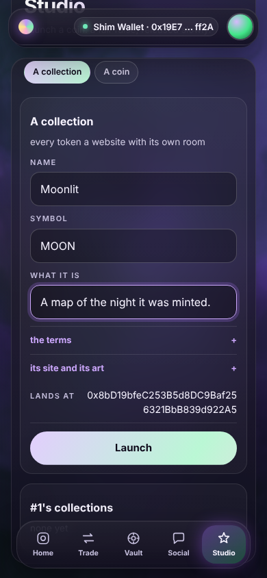
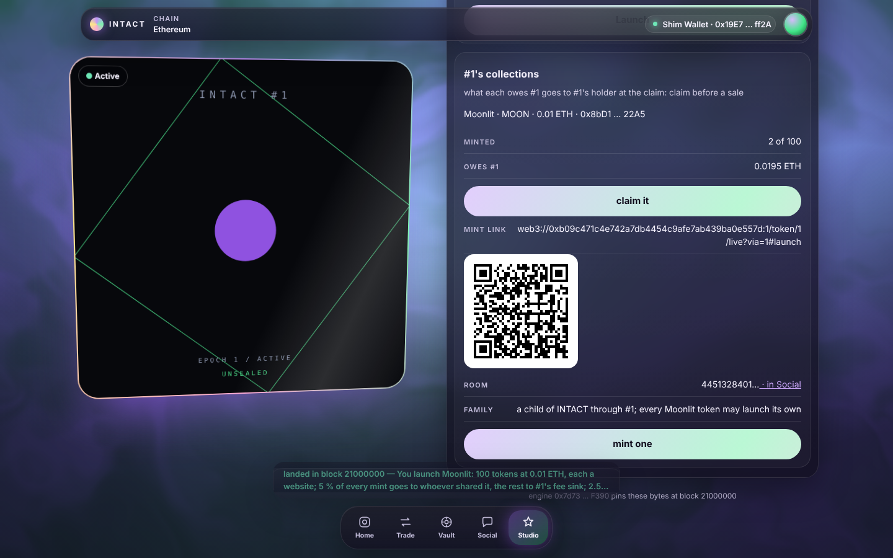

# W12 · the Studio lane: a collection beside the coin

V2 wave 2, unit W12 (`docs/V2.md` §0 row 7, §3.4, §4, §5). The owner first
asked to replace the launchpad with launches through NFTs, then to keep it:
*"Actually leave the launchpad too."* So the launch lane becomes the Studio
room, and the room offers two launches side by side, **a collection** and
**a coin**. The coin is V1's lane, unchanged. The collection launches a Studio
collection from the token whose page this is. Every token of that collection
is a website with its own room, minted through links that pay whoever shared
them.

This unit owns `engine/panels/launch.js`, `tools/verify-site/launch.mjs`, the
launch group of `tools/verify-console.mjs`, this report and
`docs/v2/shots/studio-*.png`. It was built on 2f17d92 on 2026-10-19. Every
number below was measured on this tree, and each says which run printed it.

## 1. What the lane does

- **A segmented control, `A collection | A coin`** (`#launch-mode`). These
  are the console's own tab chips (`button.chip`, `.on`, as the swap lane
  draws its tabs), with `aria-pressed`.
  - **A coin** is V1's lane: every id, every sentence and every press is as
    it was. V1's 82 assertions in the shim group and its 9 in Chromium pass
    unchanged.
  - **A collection** is drawn only where the Studio reports (`S.bits.studio`
    under `S.reported`). Elsewhere it is the §6.3 chip, *studio: not deployed
    on this chain*, and nothing is read from the codeless address
    (`studio-absent-phone.png`).
  - The room opens on the collection where the Studio reports and on the
    coin elsewhere. A V1 band therefore opens on exactly the lane it always
    had. The choice is kept in the panel's closure and survives repaints. It
    is never stored: CONSOLE §1 lets the console store only the picker's
    rdns.
- **The form** (`#launch-collection-form`). Three fields are in view: name,
  symbol, and what it is. The rest sit behind two disclosures, filled with
  defaults, so Launch is three fields away (`studio-terms-phone.png`).
  - *The terms*: 100 tokens; 0.01 ETH a mint; opens at once; never closes;
    no limit per wallet; 5 % to whoever shared the link; 2.5 % royalty.
  - *Its site and its art*: two textareas. An empty site is W4's default
    site with the name escaped in. An empty art is the Collection's default
    orb.
  - **Where it lands** (`#launch-collection-at`) is read live from
    `studio.predict(persona, salt)` as the name is typed.
- **The launch** is `studio.launch(persona, spec, salt)` with need
  `HOLD | ACCOUNT`. The slab opens with one sentence, the brief's own
  (`studio-slab-phone.png`):
  > You launch Moonlit: 100 tokens at 0.01 ETH, each a website; 5 % of every
  > mint goes to whoever shared it, the rest to #1's fee sink; 2.5 % of every
  > resale.

  An opening, a closing and a limit per wallet are added to the sentence
  when set. The spec is a tuple, so the shell draws no `[data-arg]` rows;
  every field is a line, with the salt and where it lands.
- **This token's collections** (`#launch-collections`, from
  `studio.collectionsOf(persona)`; `studio-collections-*.png`). Each row
  shows:
  - the name, the symbol, the price and the address;
  - **minted** of supply;
  - what it **owes** this token, and *claim it* (anyone may press it; it
    pays the fee sink only);
  - the **mint link** as text, with its **QR** on a light ground;
  - its **room**, Agora's `collectionKey`, as a link to Social;
  - its **family**, from `parentOf`: *a child of INTACT through #1; every
    Moonlit token may launch its own*;
  - **mint one**, which is the link's consumer.

The rest of the screenshots are `studio-form-desktop.png`,
`studio-slab-desktop.png`, `studio-mint-slab-phone.png` (a mint through #2's
link) and `studio-coin-phone.png` (the coin, one press away). Section 7 says
how they were taken.

## 2. Decisions, each with its reason

1. **Only the open segment is drawn.** Each segment's content is built only
   while it is selected. Nothing is merely hidden.
   - The V1 suites count sentences in the lane's whole `textContent`. The
     stranger's gate, for example, must appear once. A hidden collection
     form would print a second gate.
   - Neither segment reads anything for the other.
   - The cost is one repaint per press, which `typed` survives.
2. **The room opens where the chain can act.** It opens on the collection
   where the Studio reports, and on the coin elsewhere. So V1's lane is what
   a V1 band shows first, and V2's headline is what a V2 band shows first.
   `tools/testnet-drive.mjs`'s journey runs against `tools/deploy.mjs`,
   whose V2 satellites are still placeholders, so it still finds the coin
   form first. Once a band's Studio reports, the journey must press *A coin*
   first (§6, request 6).
3. **The window is counted on the chain's clock, never typed as a date.**
   - The fields are *opens in, hours* and *closes after, days*.
   - At the press, the opening is `clock() + hours × 3600`. The closing is
     the opening (or now) plus `days × 86400`.
   - The slab prints both as dates. The brief's *"a date on the chain's
     clock"* is that date.
   - This follows the V1 lock form's own pattern (*"until, days from now"*).
     It cannot be a past or mistyped wall-clock date, and Date is never asked
     the time (CONSOLE §12).
4. **The salt is the name's first 24 bytes followed by the chain's clock at
   the paint (8 bytes).**
   - It is readable in the slab, and it needs no keccak. `ui.khex` is
     reserved for the uses CONSOLE §5 lists.
   - It is fixed for one paint. So the address read live is the address the
     press sends to, and the suites hold the two equal.
   - A receipt repaints the room and reads a newer clock, so a second launch
     gets a fresh salt. A name launched twice within one block is
     `SaltUsed(0x…)` in the estimate, by name, before the wallet opens.
   - The shim rolls its block on every send (12 s), so its tests predict
     with the clock of the paint they drive.
5. **Every bound is refused by name before the wallet opens; four are
   refused in words before any read.**
   - Before any read:
     - the name, 1 to 48 bytes, and the symbol, 1 to 12, because the
       sentence names them;
     - the page and the art: 24,000 and 12,000 bytes, and 256 holes each,
       counted with lib/Template's twelve exact names left to right (W4:
       the same matcher the Studio counts with).

     Each number is also parsed here, so text that is not a number is a
     sentence, never NaN.
   - The description, supply, share and royalty bounds are the Studio's own
     refusal in the estimate: *would revert: BadSupply()* and its kind,
     before the wallet opens. This is V1's pattern too (*"a non-holder sees
     the custom error before the wallet opens"*).
   - The bytes decided this split (decision 15).
6. **The default site is W4's `sitePage`, lifted byte for byte.**
   - The suite reads the function out of `tools/verify-studio.mjs`, runs it
     apart from the panel, and requires `spec().page` to equal it, for
     "Moonlit" and for "Tide & <Co>" (whose name must come back escaped).
   - So W4's measurements apply as they stand: its Chromium sandbox check
     (no wallet, no network), its 2,903 bytes, and its gas.
   - It costs 1,544 B of the panel's gzip.
   - If W4's template changes, the shim fails until the panel's copy
     follows.
7. **The mint link is `web3://<premises>:<chain>/token/<id>/live?via=<id>#launch`.**
   - **Why `via=<id>` and not W4's 77-digit persona.** The QR holds 106
     bytes (CONSOLE §13). A hub token's persona is 77 decimal digits
     (`hub << 96 | id`), so no web3:// base can carry it in a QR. A 74-byte
     base plus `?via=` and 77 digits is about 156 bytes.
   - **Why a number is unambiguous here.** This Premises names a hub token
     by its number in every path it serves (`/token/<id>/live`), and the
     link is one of its pages. So `via` names one by number too, as V2.md
     §3.4 spells it (`?via=<token>`).
   - The link opens the creator's Studio room (the shell shows the hash's
     lane at boot), where the collection is listed with *mint one*.
   - The QR is 77 bytes on the harness and fits.
   - The panel reads `via` from `location.search`: digits only, at most 28,
     so below 2^96. Anything else is no referrer.
   - W4's persona form remains what each token's own site prints, as an
     instruction for a direct `mint(to, via)`.
8. **"Mint one" is the link's consumer.** Without it, the link would land on
   a list with nothing to press. It mints to the connected wallet, needs
   `spend`, and its value is the price.
   - It reads `spec()` again at the press, because a link carries no terms
     (W4 §7).
   - The via is the link's number. Its token is checked with
     `hub.feeSink(id)`, which reverts for a token that does not exist, so a
     number that names no token passes `via` 0. The sentence then never
     promises a share the Collection would withhold.
   - It is not limited to the creator's own link: a link re-shared as
     `?via=2` pays #2 its share.
9. **Minted of supply comes from the Minted log**, walked with
   `ui.walkLogs`. No `totalSupply` row is served, and the walk is the only
   way. An endpoint that refuses the range prints *"not counted: the
   endpoint refused the log"*, never 0 (CONSOLE §6.3). Request 4 asks for the
   row.
10. **The room key is computed, not read.** It is `keccak(4 ‖ collection)`
    through `ui.kbytes`, the same formula every Collection prints as
    `{{room}}`. `collection.room()` is not a row. This is a fourth use of the
    shell's keccak beside the three CONSOLE §5 names (request 1).
11. **The claim states the rule, not the address.** Its slab says *"it is
    paid to #1's fee sink and nobody else"*. The Collection pays
    `payeeOf(persona)`, which the hub sets to `feeSink(id)`, and nothing a
    caller does redirects it. Reading and printing the address cost about
    50 B the ceiling did not have. Identity and Home already print the Reach
    and the Grip.
12. **The QR gets a light ground through a `style` attribute.** The shell's
    QR draws its modules with no fill, on a transparent ground, so inside a
    lane's dark glass the code is dark on dark. Only `#qr` is given a white
    card. The attribute is allowed by the CSP (`style-src 'unsafe-inline'`),
    and both the shim and Chromium read it. The suites decode the QR and
    check that Chromium paints it on white at 184 px. Request 3 asks for a
    stylesheet rule instead.
13. **Every field has an accessible name.** `fld` sets `aria-label` to the
    label, for V1's fields too: the shell's `field()` draws the label as a
    `div` beside the input, which names nothing. Buttons carry their text,
    the segments `aria-pressed`, the QR the shell's `role=img` and
    `aria-label`.
14. **The creator line reads "#1".** The 77-digit persona wrapped three lines
    on a phone, and it is still in the calldata, one tap away in the facts.
15. **Bytes.** The panel is 17 B under its ceiling. Things measured on the
    way:
    - The first complete lane was 13,216 B. From there it was cut to
      12,271 B: one `ui.rows` call (every Catalog this Engine ships beside
      serves CatalogRowsV2), shorter labels and refusals, the window as
      numbers, slab lines that do not repeat their sentence, and the
      Studio's own refusals for four bounds.
    - **Arrow functions cost more gzip than `function`** (+22 B, 240 B less
      minified). V1 repeats `function(` and gzip rewards the repetition.
    - Restoring V1's inline `M` table cost 21 B more than a `table()`
      helper.
    - gzip is not monotonic here. Measure every change.
16. **A read that answers nothing is a sentence, never a throw.** Both
    read chains end in `.catch`: the address read live, and each
    collection's row. So an empty answer, where `r.a(0)` would throw inside
    the success handler, prints *not reported: …*, as every other unread
    fact does. The mutation probe found this. The `.then(ok, err)` shape
    leaves a throw inside `ok` unhandled. In any suite that compiles,
    soljson's process-wide `unhandledRejection` handler rethrows it, and
    the run dies before its summary. That was the first probe's two
    "survivors": suites that crashed. A browser only logs it as a
    pageerror.

## 3. Measured

| What | Measured | Printed by |
|---|---|---|
| launch panel, gzip | **12,271 B** of 12,288 (31,707 inflated); 8,155 before; W4's default site is 1,544 B of it | `node tools/build-app.mjs` |
| the shell and the other panels | unchanged: shell 22,149 B; swap 8,172 · social 8,187 · vault 8,166 · identity 8,185 · agent 4,883 | `node tools/build-app.mjs` |
| `node tools/verify-site.mjs --group launch` | 113 passed, 0 failed (107 in the group: V1's 82 and V2's 25) | the run's last line |
| `node tools/verify-console.mjs --group launch` | 20 passed, 0 failed (17 in the group: V1's 9 and V2's 8) | the run's last line |
| `node tools/verify-site.mjs` (all groups) | **629 passed, 0 failed**; 604 before, plus V2's 25. By group: boot 131 · swap 84 · social 76 · launch 107 · vault 68 · identity 88 · agent 68 | the run's last line |
| `node tools/verify-console.mjs` (all groups) | **182 passed, 0 failed**; 174 before, plus V2's 8. The viewer's button sweep presses both segments and nothing prompts | the run's last line |
| `node tools/build-app.mjs` | the shell 22,149 B of 24,000; launch 12,271 B of 12,288; the other five panels unchanged | the run's summary |
| `node tools/selftest.mjs` | **60 passed, 0 failed** | the run's last line |
| `node tools/verify.mjs` | **249 passed, 0 failed** | the run's last line |
| `node tools/static-audit.mjs` | **static audit passed — 10 Solidity rules, 4 JS rules** | the run's last line |
| focus and names in the Studio room, in Chromium | 57 focuses at each size over 19 controls; **0 wholly hidden, 0 partly covered** by the crest bar, the dock or the ticker; **every control named** (its `aria-label` or its text). Method: a scratch probe pressed Tab 80 times at 390×844 and 1440×900, over the form with both disclosures open and the list with its claim and mint, and took five samples per focused box | the probe's JSON line |

**The mutation probe.** INVARIANTS rows go live only once their test has
been seen to fail under a one-character mutation. `tools/mutations.mjs`
mutates Solidity, so this unit probed its panel the same way, with a
scratch runner outside the tree.

- **Method.** Each row writes one mutation of `engine/panels/launch.js`
  over the file in a copy of the tree, then runs
  `node tools/verify-site.mjs --group launch` there. The file is restored
  after every row, in a `finally` and on SIGINT.
- **Result, on the final panel: 15 killed, 0 survived, 0 not mutations.**
  At the end the file equalled the original by sha256.
- **The first probe, on the panel before decision 16, read 13 killed and
  2 "survived".** Both "survivors" were suites that crashed before their
  summary on an unhandled rejection (decision 16). The runner counted a
  crash as a survival; it now counts it as a failed suite.

| Row | Guard | Mutation | Killed by (the first failing sentences) |
|---|---|---|---|
| salt | the salt is the name and the paint's clock | `padStart(16` → `padStart(15` | *the address is shown live from studio.predict(persona, salt) …*, *a tuple draws no [data-arg] rows …* (4 failed) |
| mode | the room opens on the collection only where the Studio reports | `S.reported & S.bits.studio` → `S.absent & …` | V1's *J1 the raise is listed with its coin …* and the group threw |
| chip | a Studio that does not report is the chip, and nothing is read | `if (three(…)) return` → `if (!three(…)) return` | *A collection is the chip where the Studio does not report, and nothing is read from its codeless address*, then the group threw |
| gate | only `HOLD \| ACCOUNT` is offered the form | `rights() & (HOLD\|ACCOUNT)` → `rights() \| (…)` | *only the holder or its Reach is offered the form …* |
| holes | more than 256 holes is refused before any read | `k > 256` → `k > 2560` | *a 25,000-byte page is refused …*, *a template of 300 holes is refused …* (3 failed) |
| bytes | a template over its bytes is refused before any read | `b.n > max` → `b.n > max * 2` | the same two (3 failed) |
| opens | the opening is hours on the chain's clock | `oh * 3600n` → `oh * 360n` | *the window is the chain's clock at the press …*, *Tide lands where it was shown …* |
| via | the link's number is a hub token's persona | `HUB << 96n` → `HUB << 95n` | *a mint through the shared link credits the referrer …*, *the same link re-shared as #2's …* (3 failed) |
| noToken | a number that names no token is no referrer | `v = 0n` → `v = 9n` | *a link naming no token is no referrer …* |
| share | the sentence names the sharer only when it is not the creator | `v !== P` → `v === P` | *a mint through the shared link credits the referrer …*, *the same link re-shared as #2's …* |
| claim | the claim is drawn only while something is owed | `can && o` → `can \|\| o` | *#1's collections list it: … nothing owed …* |
| link | the mint link names the referrer as via | `?via=` → `?vie=` | *#1's collections list it …*, *the QR encodes the mint link …* (3 failed) |
| ground | the QR sits on a light ground | `#fff` → `#000` | *the QR encodes the mint link, decoded apart from the shell, on a light ground* |
| site | the default site is W4's byte for byte | `--a:266` → `--a:267` in the template | *the spec read back from the chain equals the form …*, *the default site's holes are filled in pageOf …* (3 failed) |
| room | the room is Agora's `collectionKey` | `"0x04"` → `"0x03"` | *#1's collections list it: … its room (Agora's collectionKey) …* |

## 4. Element ids this lane adds

They are also in the panel's header comment. Every selector is scoped to
`#lane-launch`.

| Element | Meaning |
|---|---|
| `#launch-mode` | the segmented control: `button.chip` *A collection* and *A coin*, `.on` and `aria-pressed` on the open one |
| `#launch-collection` | the collection section, or the `studio` chip in its place |
| `#launch-collection-form` | the form, for `HOLD \| ACCOUNT` only; `input[name=name\|symbol\|about\|supply\|price\|opens\|closes\|limit\|share\|royalty]`, `textarea[name=page\|art]`, the terms and the site behind two `details` |
| `#launch-collection-at` | where `studio.predict(persona, salt)` says the collection will land, live |
| `#launch-collections .collection[data-address]` | one per `collectionsOf(persona)`: a heading (name · symbol · price · address), then `.kv` rows keyed *minted*, *owes #<id>*, *mint link*, *room* (`[data-room]` = the key, with `a[href="#social"]`), *family*; the QR as `svg[role=img]` |
| `[data-act=collectionLaunch\|collectionMint\|collectionClaim]` | the launch (need `HOLD \| ACCOUNT`), the mint (anyone's, `[data-spend]`), the claim (anyone's, drawn only while something is owed) |

## 5. Proposed INVARIANTS rows

All of these are **pending (W12)** until they run in `npm run check` and are
seen to fail under a one-character mutation. The sentences are quoted
verbatim from the files. Both suites are already battery steps
(`verify:site`, `verify:console`).

The probe in §3 has already seen these fail under a one-character mutation:
- W12-1's chip sentence;
- W12-2's live address;
- W12-3's lines and its spec read-back;
- W12-4, W12-5, W12-6, W12-7 and W12-9;
- W12-10's gate.

Not yet mutated: W12-8, and W12-10's viewer and mint-log sentences.

| # | Claim | Enforced by |
|---|---|---|
| W12-1 | The Studio room opens on the coin wherever the Studio does not report; there the collection is the §6.3 chip and nothing is read from the codeless address | `tools/verify-site/launch.mjs` · *"where the Studio does not report, the room opens on A coin, V1's lane as it was"*, *"A collection is the chip where the Studio does not report, and nothing is read from its codeless address"* |
| W12-2 | The address shown before a collection launch is where it lands (`studio.predict` with the salt the press sends) | `tools/verify-site/launch.mjs` · *"the address is shown live from studio.predict(persona, salt) as the name is typed, the salt the name and the chain's clock"*, *"the address shown before the launch is where the collection landed: Launched and collectionsOf name it, from #1, child of the hub"*; `tools/verify-console.mjs` · *"three fields and Launch: the slab says the one sentence and the address it lands at, the address shown before the press"*, *"it landed where it was shown, and its row prints the mint link and a QR Chromium paints on white and jsqr reads back as the link"* |
| W12-3 | The launch slab is one sentence naming every term, and every field of the spec is a line (a tuple draws no `[data-arg]` rows); the spec read back equals the form; the default site is W4's byte for byte | `tools/verify-site/launch.mjs` · *"the launch is one sentence before the signature, the brief's own: You launch Moonlit: 100 tokens at 0.01 ETH, each a website; 5 % of every mint goes to whoever shared it, the rest to #1's fee sink; 2.5 % of every resale."*, *"a tuple draws no [data-arg] rows, so every field of the spec is a line, and the calldata carries the persona and the salt the lines name"*, *"the spec read back from the chain equals the form, and its page is W4's default site byte for byte, the name written in"* |
| W12-4 | The page and art bounds (24,000 / 12,000 bytes, 256 holes) are refused in words before any read and any slab | `tools/verify-site/launch.mjs` · *"a 25,000-byte page is refused in words before any read and any slab"*, *"a template of 300 holes is refused in words before any read and any slab"*; `tools/verify-console.mjs` · *"a 25,000-byte page pasted into the site is refused in words before any slab, in Chromium"* |
| W12-5 | A mint through the shared link credits the referrer it names, and a number that names no token is no referrer | `tools/verify-site/launch.mjs` · *"a mint through the shared link credits the referrer: the Minted log names #1's persona as via with its 5 % share, and #1 is owed the price"*, *"the same link re-shared as #2's credits #2 its 5 % and #1 the rest"*, *"a link naming no token is no referrer: the mint passes via 0 and says nothing of a share"*; `tools/verify-console.mjs` · *"a mint through the shared link credits the referrer, in Chromium: the Minted log names #1 with its 5 % share"* |
| W12-6 | The QR encodes the mint link | `tools/verify-site/launch.mjs` · *"the QR encodes the mint link, decoded apart from the shell, on a light ground"* |
| W12-7 | The default site's holes are filled in `pageOf` with the chain's values | `tools/verify-site/launch.mjs` · *"the default site's holes are filled in pageOf: id, seed, holder, epoch, memories, minted, supply, price, collection, creator, room, chain"* |
| W12-8 | The creator's claim pays the creator token's fee sink exactly what was owed | `tools/verify-site/launch.mjs` · *"the creator's claim pays #1's fee sink, its Reach, exactly what was owed"*; `tools/verify-console.mjs` · *"the creator's claim pays #1's fee sink exactly what was owed"* |
| W12-9 | A collection's window is the chain's clock at the press | `tools/verify-site/launch.mjs` · *"the window is the chain's clock at the press: opens in 2 hours, closes 7 days after, both in the sentence"* |
| W12-10 | Only the holder or its Reach is offered the form; the viewer reads every collection and offers nothing; a refused mint log is not counted, never 0 | `tools/verify-site/launch.mjs` · *"only the holder or its Reach is offered the form: a stranger reads the gate once, every collection, and a mint"*, *"the viewer reads every collection, its link and its QR, and offers nothing to press"*, *"a mint log the endpoint refuses is not counted, never 0 minted"* |

## 6. Requests for files this unit does not own

1. **`docs/CONSOLE.md`**
   - **§6.2, the launch row:** add the elements of §4 above, with
     `[data-spend]` on `collectionMint`. Also say that the room opens on *A
     collection* where the Studio reports and on *A coin* elsewhere.
   - **§5, `khex`/`kbytes`:** the row says their uses are the two trait
     keys, the social lane's `pairKey` "and nothing else". Add the launch
     lane's room key, Agora's `collectionKey` = `keccak256(4 ‖ collection)`
     (decision 10).
   - **§5, a new line:** the launch lane reads `location.search` for `via`.
     It is read-only, digits only, below 2^96, and it is the one thing a
     panel reads outside `INTACT.ui`. The shell itself reads `?as=` the same
     way.
   - **§10 or §19:** the mint link's shape is
     `web3://<premises>:<chain>/token/<id>/live?via=<id>#launch`, and
     `via` is a hub token's number (decision 7).
2. **`engine/app.html` (W7):** `ROOMS.launch` still describes V1's room as
   *"Launch a coin: a fair raise, released slowly."* It appears above the
   segmented control in every screenshot. Proposed: *"Launch a collection
   of websites, or a coin."*
3. **`engine/app.css` (W7):** a rule for a QR inside a lane, for example
   `#lane svg[role=img]{display:block;width:184px;max-width:100%;border-radius:16px;background:#fff}`.
   - The shell's QR draws modules with no fill on a transparent ground.
     Only `#qr` is given a white card, so inside a lane the code is dark on
     dark (decision 12).
   - The launch panel then drops its `style` attribute and gets back about
     30 B.
   - The vault's Grip QR is in a lane too and, by the same reading of the
     stylesheet, is dark on dark. It was not screenshotted here.
4. **`src/Catalog.sol` `CatalogRowsV2` (W6, at integration):** two additive
   rows under `c`:
   - `collection.totalSupply` (`totalSupply()`). Minted is then one
     `eth_call`, instead of a Minted-log walk from block 0 that public
     endpoints refuse (decision 9).
   - `collection.room` (`room()`). The room key is then read rather than
     hashed in the page.

   The drift gate in `tools/verify.mjs` holds both to `ICollection`.
5. **`docs/INVARIANTS.md`:** the rows of §5, pending (W12).
6. **`tools/verify-console.mjs` `journey()` and `tools/testnet-drive.mjs`
   (not this unit's group):** once a band's Studio reports, the Studio room
   opens on *A collection*. The journey must then press
   `#lane-launch #launch-mode button` *A coin* before it waits for
   `#launch-coin-form`. Today its chain (`fresh()`, and `tools/deploy.mjs`'s
   placeholders over a wire) has no Studio, so nothing is needed yet.
7. **`CLAUDE.md`, four traps:**
   - The launch panel is 17 B under its ceiling (12,271 of 12,288), and W4's
     default site is 1,544 B of it. In this panel arrow functions cost more
     gzip than `function`, because V1 repeats `function(`.
   - Chromium hides a closed `
` with `content-visibility`, so its
     fields keep client rects. Ask `checkVisibility()`.
   - The shim rolls its block, 12 s, on every `eth_sendTransaction`. A
     paint after a receipt therefore reads a newer clock.
   - `node_modules/solc/soljson.js` registers
     `process.on("unhandledRejection", reason => { throw reason; })`. Every
     suite that calls `compile()` loads it, so a panel's unhandled rejection
     in the shim kills the run before its summary. A panel's promise chain
     must end in `.catch`; `.then(ok, err)` does not cover a throw in `ok`.
8. **One source for the default site (`tools/build-app.mjs`, U7/W7;
   `tools/verify-studio.mjs`, W4):** `sitePage` now lives in two files,
   held equal by the shim. A module both could inline, as `whispers.mjs` is
   inlined into the social panel, would make it one file.
9. **The Gallery (W8):** a mint flow there for any Studio collection would
   read W4's persona form. This lane's `?via=<id>` (below 2^96) and the
   persona form (at or above 2^96) are disjoint, so a reader can accept
   both.
10. **Not in any interface, so not in this lane:** V2 §5.4's honour for the
    parent's holders (an allowlist or a discount), and §4's coin as a room's
    currency. The lane says only what holds: *every Moonlit token may launch
    its own*.

## 7. How the screenshots were taken

A scratch script, kept in the scratchpad rather than the tree, used
`tools/verify-console.mjs`'s own `fresh()`, `openBrowser()` and `openPage()`.
That means an in-process chain, `deploySite` from `dist/`, the in-process
gateway on 127.0.0.1, and the shim's wallet over EIP-6963, in the battery's
Chromium. It ran `fresh({ v2: true })` for the Studio, with #1 and #2 to the
holder, and a plain `fresh()` for `studio-absent-phone.png`.

- The holder typed three fields and launched Moonlit.
- The buyer minted twice through the link: `?via=1`, then `?via=2`.
- Each view was taken at 390×844, and the form, the slab and the list also
  at 1440×900.

As in W7's shots, the soul is a still: this Chromium renders WebGL through
SwiftShader. No page logged an error.
