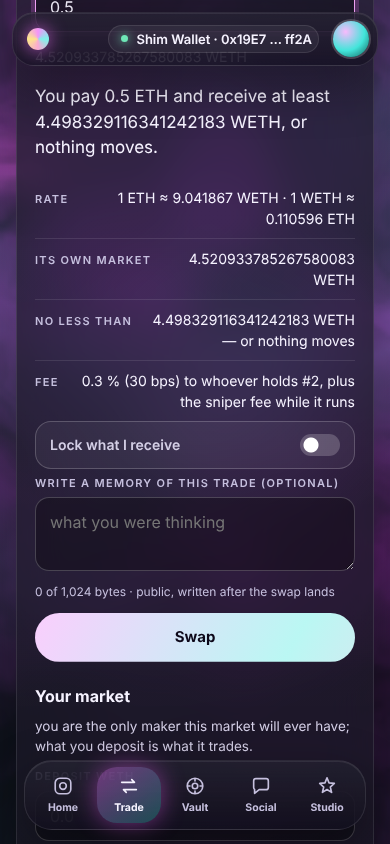
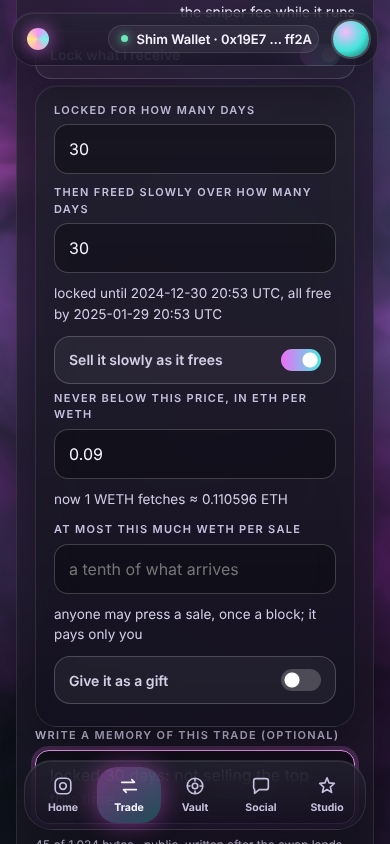
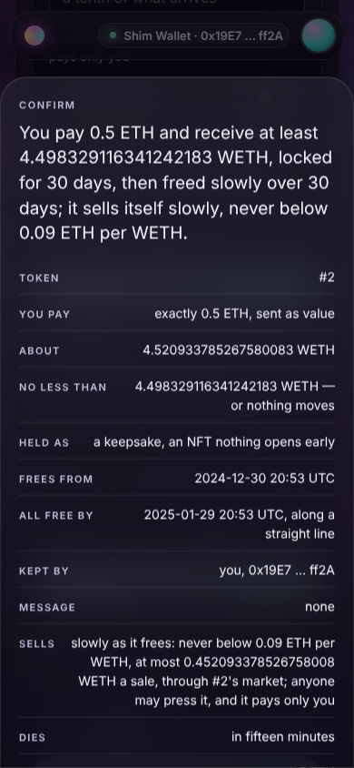
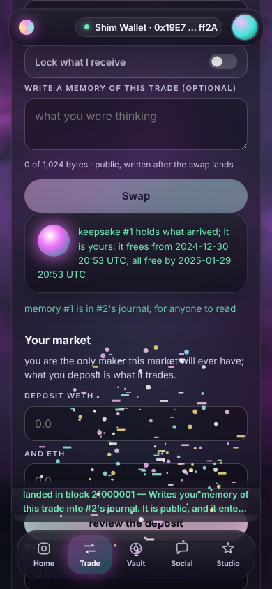
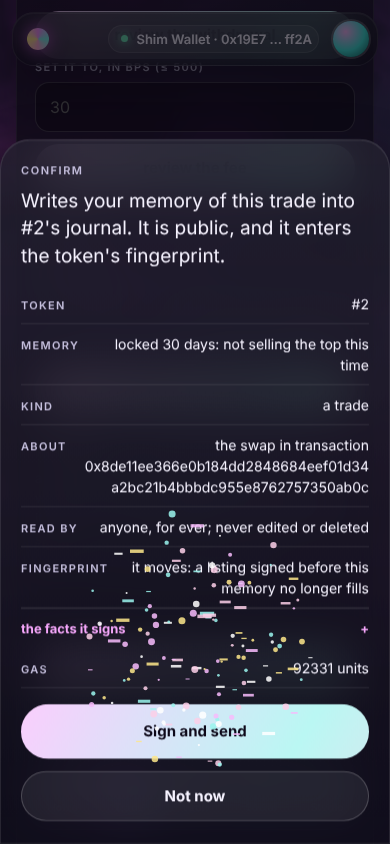
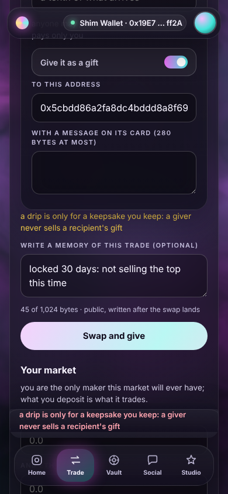

# W9 · the Trade lane: lock what a swap brings, sell it slowly, remember the trade

V2 wave 2, unit W9 (docs/V2.md §0 rows 2–3, §2, §3.1, §3.2). The owner asked
for two things in the Trade room: *"lock after a swap, and allow for slow
selling after unlock"*, and *"inscribe memories during a swap, like a trading
journal"*, in an interface that is *"extremely user friendly, art within
art"*. This unit builds both into `engine/panels/swap.js` on top of the V1
lane, proves them through the shim and in Chromium, and changes nothing the
V1 suites assert. Every number below was measured on this tree (2f17d92 plus
this unit's changes, 2026-10-19), and each sentence says which run printed it.

Files: `engine/panels/swap.js`, `tools/verify-site/swap.mjs`, the swap group of
`tools/verify-console.mjs`, this report, `docs/v2/shots/trade-*.png`.

## 1. What the lane does

**The card says in one breath what the slab will say.** Under the quote,
`#swap-say` reads, for example, *"You pay 0.5 ETH and receive at least
4.498329116341242183 WETH, or nothing moves."* — the floor in words, at full
precision, the same words the slab opens with. The rate is given both ways
(*"1 ETH ≈ 9.041867 WETH · 1 WETH ≈ 0.110596 ETH"*, about six significant
figures, never a flat zero); the fee in percent beside its bps (*"0.3 % (30
bps) to whoever holds #2"*); the sniper countdown in plain time, *"500 bps at
open, falling to nothing — M min S s left"* where V1 printed *"… decaying — N
s left"* (V1's sentence matched `\d+ s left` and still does).

**"Lock what I receive"** is a switch (`button[role=switch]`, its state in
`aria-checked`, drawn as a knob in the token's two hues). On, it asks:

- *locked for [30] days, then freed slowly over [30] days* — two day counts.
  The dates come from the chain's clock (`ui.clock()`, re-read when the switch
  turns on) and are printed under the fields: *"locked until 2024-12-30 20:53
  UTC, all free by 2025-01-29 20:53 UTC"*.
- *Sell it slowly as it frees* (a switch): *never below [price] ETH per WETH*,
  and *at most [x] WETH per sale* (a tenth of what arrives unless typed). Beside
  the price, what one of it fetches now (*"now 1 WETH fetches ≈ 0.110596 ETH"*).
- *Give it as a gift* (a switch): *to this address* and *a message on its card
  (280 bytes at most)*. A drip is only for a keepsake you keep.

With the lock on, the swap is the Keepsake's `swapAndWrap(p)`: native input
rides as `value = amountIn`; an ERC-20 input is an exact approval to the
Keepsake first, as the button's current step (*"Approve 1 WETH — the current
step"*, then *"Swap and lock"* on the same button). The slab's sentence says
it all in one breath: *"You pay 0.5 ETH and receive at least
4.498329116341242183 WETH, locked for 30 days, then freed slowly over 30 days;
it sells itself slowly, never below 0.09 ETH per WETH."* A gift names its
recipient: *"You pay 0.2 ETH and give at least … WETH to 0x5CbDd86a2FA8Dc4bDdd8a8f69dBa48572EeC07FB,
locked for 7 days, then freed slowly over 90 days."*

After the receipt, `#swap-kept` shows the keepsake — its id read from the
receipt's `Wrapped` log, never from a read after the write — as a glass card
with an orb in the token's light: *"keepsake #1 holds what arrived; it is
yours: it frees from 2024-12-30 20:53 UTC, all free by 2025-01-29 20:53 UTC"*.

**"Write a memory of this trade"** is a textarea (optional, at most 1,024
bytes, counted as the chain counts them: *"45 of 1,024 bytes · public, written
after the swap lands"*). Only the holder is offered it — only the holder writes
a token's journal. After the swap's receipt lands, a second slab proposes
`Journal.inscribe(hub, id, TRADE, body, ref)` with `ref` the swap's
transaction hash. Its sentence: *"Writes your memory of this trade into #2's
journal. It is public, and it enters the token's fingerprint."*; its lines
add *"Read by · anyone, for ever; never edited or deleted"* and *"Fingerprint ·
it moves: a listing signed before this memory no longer fills"*. *Not now*
writes nothing and leaves `[data-act=inscribe]` in the kept box, so the memory
is offered and never forced. A memory follows a Router swap (the Elsewhere tab)
the same way.

**The chip rule.** Each part appears only where its contract reports
(`S.bits.keepsake`, `S.bits.journal` with `S.reported` / `S.absent`). Where it
does not, its §6.3 chip stands in its place — *"keepsake: not deployed on this
chain"* (or *"could not be read at block N"*), *"journal: …"* for the holder —
and nothing is read from the address.

**Refusals in words, before any wallet.** A drip asked for a gift is refused
under the switch (`#swap-lock-why`) and at the press, with no slab and no
estimate:

So are a lock of no days, one past ten years (3,650 days, the Keepsake's
`MAX_TERM`), a gift's message over 280 bytes, a gift to your own address, a
gift to a mixed-case address that is not its own EIP-55 checksum (a typo, and
a gift is not taken back), a memory over 1,024 bytes (its counter turns red),
and the lock in exact-out mode. Two refusals belong to the chain, and the
estimate says them in the Keepsake's own words before any wallet, with Sign
disabled: the Keepsake as its own recipient (*"would revert:
ZeroRecipient()"*), and a schedule the chain's clock puts in the past, which
the panel cannot see because it builds from the clock it is given (*"would
revert: BadSchedule()"*).

Desktop, 1440×900: `trade-desktop-card.png`, `-lock.png`, `-refusal.png`,
`-slab.png`, `-memory-slab.png`, `-kept.png`. The shots were taken with
Playwright's Chromium against the built document served the way
`tools/verify-console.mjs` serves it (its own `fresh()`: an in-process chain,
`deploySite(…, { v2: true })` from `dist/`, the in-process gateway on
127.0.0.1, the shim's wallet over EIP-6963), at 390×844 and 1440×900. That
chain's clock starts at its genesis, 1,733,000,000 s (2024-11-30 20:53:20
UTC), so the dates in them fall in 2024 and 2025: they are the chain's dates,
not this machine's. The headless Chromium renders WebGL through SwiftShader,
so the sky is a still (W7 decision 9).

## 2. Decisions, each with its reason

1. **The drip's price is what was paid per one of what arrives.** The drip
   sells what the swap brought (the keepsake's asset 0) for what was paid, and
   a floor protects a seller only in proceeds per unit sold. So the field reads
   *"never below this price, in ETH per WETH"* and the raw floor the Keepsake
   reads (`minOut = ceil(sold × floor / 1e18)`) is `parse(P, decPaid) × 1e18 /
   10^decReceived`, rounded up, so it never falls below what was typed — W1's
   formula with the drip's own output and input. **The brief's example said
   *"never below 9.4 WETH per ETH"***: that is the swap's rate the other way
   round, and "never below" a WETH-per-ETH number is a ceiling on a WETH
   seller, the opposite of what the chain enforces. The lane says the price
   the way the chain holds it (*"never below 0.09 ETH per WETH"*), and the
   card prints what one WETH fetches now beside the field.
2. **The floor is never prefilled.** V2 §3.1: the floor is the whole price
   guard, so the person names the worst price they accept; an empty field is
   refused in words (*"name the lowest price it may sell at, in ETH per
   WETH"*). The per-sale amount does default — to a tenth of what the press's
   re-quote says will arrive, never zero — as the brief asks.
3. **A flip clears the floor and the per-sale amount.** Both are in the pair's
   units; turning the pair round would otherwise read a typed floor the other
   way round (0.0005 ETH per USD becoming 0.0005 USD per ETH). The fields empty,
   their labels follow the pair, and the person types again.
4. **The schedule.** `start = now + L days` (0, the block's own time, when L is
   0), `cliff = 0` (the Keepsake reads it as the start), `end = now + (L + F)
   days`, where `now` is `ui.clock()` read at the press. The release line runs
   from `start`, so a start at now with a cliff at L days would free L/(L+F) of
   it at once at the cliff; "locked for 30 days, then freed slowly over 30"
   means nothing before day 30 and a straight line from day 30 to day 60. F = 0
   frees everything at once at the lock's end (three equal dates). The deadline
   (15 minutes) is always before a future start, so a start can only be in the
   past when the clock itself is behind — which the estimate catches.
5. **Two slabs from the wallet, not one Reach batch.** The swap pays from the
   wallet, so the memory is a second transaction by the holder's wallet
   (Journal's `acts`: the holder or the Reach), and its `ref` is the swap's
   transaction hash (request 3 for the viewer).
6. **The memory belongs to its trade.** It is captured at the press (trimmed,
   UTF-8, ≤ 1,024 bytes), offered only after a receipt with status 1 (a
   reverted swap offers nothing), and replaced by the next landed swap; after a
   landed lock or memory the card starts afresh, V1's rule (*"what follows is
   typed afresh"*): the next swap is unlocked until the switch is turned on
   again.
7. **The lock is exact-in only.** `swapAndWrap` takes `amountIn` and `minOut`;
   in exact-out mode the lock is refused in words rather than silently
   re-reading the typed amount as what is paid.
8. **A lock goes through the token's own market.** `swapAndWrap` swaps on the
   Pool; on the Elsewhere tab a lock that is on is refused in words (*"a lock
   goes through #2's own market: turn it off to swap through the Router"*).
9. **The id comes from the log, and the Keepsake is never read.** The panel
   sends no `eth_call` to the Keepsake at all — the estimate and the send are
   the shell's — so "never a read after the write" is a count of zero, which
   the shim asserts.
10. **Where a chip goes.** A chip stands exactly where its part would: the
    lock's for anyone who could press Swap (the console, with an account), the
    journal's for the holder. A viewer, a session page or a wallet that is not
    connected sees neither, as they see no Swap.
11. **A Catalog without the V2 rows silences the parts, not the lane.** The two
    V2 rows are declared in their own `try`; a missing or disagreeing row is
    printed where the parts would be and every V1 control still works.
12. **The plain swap's sentence speaks the card's words.** *"You pay 1 WETH and
    receive at least … ETH, or nothing moves; it goes through #2's market and
    dies in fifteen minutes."* No suite asserted V1's sentence; every
    V1 line the suites assert (*"No less than … — or nothing moves"*, *"Pay at
    most …"*, *"Dies · in fifteen minutes"*) and every V1 id is unchanged.
13. **Every field is labelled.** V1's fields carried a visible label and no
    programmatic one; every field in the lane (V1's included) now carries an
    `aria-label` equal to its visible label. The switches are buttons with
    `role=switch` and `aria-checked`; focus rings are the shell's.
14. **The lane's own light lives in one scoped `<style>` in the head.** Five
    rules, all under `#lane-swap`: the switch row and its knob (off: white on
    glass; on: white on the token's two hues), the one breath at 17 px, and the
    keepsake's orb (`#swap-kept .keepsake::before`). It is written once by
    `textContent` (never markup), in the head rather than the lane because the
    suites read whole-lane `textContent` (W7 decision 4). Nothing animates, so
    `html.alive` is not needed. It costs ≈ 400 B of the panel's gzip (the build
    read 11,597 B just before it and 12,001 B with it, the switch's state moved
    from `.on` to the knob and the card class it needs included); request 2
    moves it into `engine/app.css`.
15. **A gift's address must be its own checksum when it is mixed-case.**
    `isAddr` accepts any 40 hex digits, so a mixed-case address with one letter
    mistyped would pass, and a gift cannot be taken back. An all-lower or
    all-upper address carries no checksum and is taken as typed; the sentence
    and the lines print it checksummed in full either way.
16. **Where the chain already refuses by name, the panel does not repeat it.**
    The Keepsake as its own recipient is `ZeroRecipient()` in the estimate,
    before any wallet; the panel's own copy of that check was cut to pay for
    the checksum guard, and the suite proves the chain's words instead.

## 3. Measured

The baselines were run on the untouched tree first (2f17d92), so any later
failure would be this unit's. The final column is one run of each, in this
order, on the final sources (panel sha256 `449e0667…c879987`), 2026-10-19:

| What | Before (2f17d92) | After (this unit) | Printed by |
|---|---|---|---|
| panel `swap`, gzip | 8,172 B | **12,044 B** of 12,288 (244 B under) | `node tools/build-app.mjs` |
| the shell, gzip | 22,149 B | 22,149 B (untouched) | `node tools/build-app.mjs` |
| `node tools/verify-site.mjs` (all groups) | 604 passed, 0 failed | **656 passed, 0 failed** | its last line |
| — of which the swap group | 84 assertions | **136** (the 84 V1 assertions unchanged, and 52 V2) | the group's count |
| `node tools/verify-site.mjs --group swap`, again on the files committed (after a comment-only edit to the group's header) | 90 passed, 0 failed | **142 passed, 0 failed** | its last line |
| `node tools/verify-console.mjs` (all groups) | 174 passed, 0 failed | **181 passed, 0 failed** (Chromium 141.0.7390.37) | its last line |
| — of which the swap group | 22 assertions | **29** (22 V1, 7 V2) | the group's count |
| `node tools/selftest.mjs` | 60 passed, 0 failed | 60 passed, 0 failed | its last line |
| `node tools/verify.mjs` | 249 passed, 0 failed | 249 passed, 0 failed | its last line |
| `node tools/static-audit.mjs` | passed | static audit passed — 10 Solidity rules, 4 JS rules | its last line |

Two V1 sentences were tightened, not changed: the absent Router's *"the
hidden tab says which spelling: not deployed on this chain"* and its
unanswering twin now match the router's own chip (`router: not deployed on
this chain`, `router: could not be read at block`), because since V2 the lane
may also carry the keepsake's *not deployed* chip, which would have satisfied
the looser pattern. The same in the Chromium group's E sentence.

### Mutation evidence

One-token or one-clause mutations of `engine/panels/swap.js`, each aimed at
one V2 guard. A driver in this unit's scratch folder (not committed) wrote
each mutant over the panel, rebuilt `dist/` with `node tools/build-app.mjs`,
ran the swap group's V2 block (`lockAndMemory`, on a ctx built exactly as
`tools/verify-site.mjs` builds one) and recorded the sentences that failed,
then restored the panel; at the end it compared the panel with its original
by sha256 and rebuilt `dist/`. The run below is on the final sources (the
panel `449e0667…c879987`, the group file as committed), 2026-10-19, on four
cores shared with three other units' campaigns (about three minutes a
mutant). Two earlier runs on the way there agree with it: 18 of 18 killed on
the panel before the checksum guard (where m18 was killed only by a helper
throwing, which is why V5 now fails by name first), and 2 of 2 on the final
one. Where a mutant stops the swap from landing (m2, m11), the V2 block ends
early after its named sentence has failed, so its count is short.

| # | Guard | Mutation (one token or one clause of `engine/panels/swap.js`) | Verdict | First sentences that failed |
|---|---|---|---|---|
| m1 | the floor crosses decimals: IN units per 1e18 OUT units | `b = 10n ** BigInt(OUT.dec); t.P = x;` → `b = 10n ** BigInt(IN.dec); t.P = x;` | killed (49 passed, 3 failed) | *"the drip's floor is stated in words as 0.0005 ETH per USD and found raw in the calldata as 5e26, with at most a tenth of what arrives a sale"*, *"and keepsakeOf reads it back: the holder, the schedule, what arrived, and the drip with the very floor the words named"* |
| m2 | the drip sells into the token's own market | `t.P ? [0n, ID, t.floor, t.most]` → `t.P ? [0n, 0n, t.floor, t.most]` | killed (11 passed, 3 failed) | *"the lock is one slab: Keepsake.swapAndWrap, the ether as its value, the card's one breath as its sentence, and the estimate passes"*, *"the drip's floor is stated in words as 0.0005 ETH per USD and found raw in the calldata as 5e26, with at most a tenth of what arrives a sale"* |
| m3 | at most a tenth of what arrives a sale, unless typed | `(q \|\| 0n) / 10n \|\| 1n` → `(q \|\| 0n) / 5n \|\| 1n` | killed (49 passed, 3 failed) | *"the drip's floor is stated in words as 0.0005 ETH per USD and found raw in the calldata as 5e26, with at most a tenth of what arrives a sale"*, *"and keepsakeOf reads it back: the holder, the schedule, what arrived, and the drip with the very floor the words named"* |
| m4 | the memory's ref is the swap's transaction | `hexOf(m.body), m.hash]` → `hexOf(m.body), S.hub]` | killed (48 passed, 4 failed) | *"after the receipt a second slab offers the memory: Journal.inscribe(hub, #1, TRADE, the words, the swap's transaction), its sentence saying it is public and enters the fingerprint"*, *"the Inscribed log carries it: memory #1 of #1, kind TRADE, by the holder, the body as typed, its ref the swap's own transaction"* |
| m5 | the memory's kind is TRADE | `BigInt(ID), 1n, hexOf(m.body)` → `BigInt(ID), 0n, hexOf(m.body)` | killed (48 passed, 4 failed) | *"after the receipt a second slab offers the memory: Journal.inscribe(hub, #1, TRADE, the words, the swap's transaction), its sentence saying it is public and enters the fingerprint"*, *"the Inscribed log carries it: memory #1 of #1, kind TRADE, by the holder, the body as typed, its ref the swap's own transaction"* |
| m6 | the keepsake's id is the Wrapped log's first topic | `S.topics.wrapped, 1)` → `S.topics.wrapped, 2)` | killed (46 passed, 6 failed) | *"the keepsake's id is read from the receipt's Wrapped log, and nothing is asked of the Keepsake after the write"*, *"lock what I receive: one slab swaps and wraps, the keepsake's id from the Wrapped log, then the memory"* |
| m7 | a part shows only where its contract reports | `if (S.reported & bit) return true;` → `if (true) return true;` | killed (48 passed, 4 failed) | *"without a Keepsake the lock is its chip, not deployed on this chain — and a trader is offered no memory at all"*, *"and to the holder the memory is the journal's chip, not deployed on this chain"* |
| m8 | a drip is refused for a gift | `if (LK.drip) return "a drip is only` → `if (0) return "a drip is only` | killed (50 passed, 2 failed) | *"a drip asked for a gift is refused in words under the switch and at the press: no slab, no estimate"*, *"a refusal is said in words: a drip asked for a gift, no days, past ten years, a long message or memory, exact out, and a schedule in the past"* |
| m9 | the lock's start is now plus its days, on the chain's clock | `t.L ? now + t.L * 86400n : 0n` → `t.L ? now : 0n` | killed (46 passed, 6 failed) | *"in the calldata: the market, the ether in, the floor, a deadline fifteen minutes on the chain's clock, and a schedule locked 30 days then freed over 30 from that clock"*, *"lock what I receive: one slab swaps and wraps, the keepsake's id from the Wrapped log, then the memory"* |
| m10 | only the holder is offered the memory | `if (!(ui.rights() & R.HOLD)) return;` → `if (!(ui.rights() & R.USE)) {}` | killed (48 passed, 4 failed) | *"without a Keepsake the lock is its chip, not deployed on this chain — and a trader is offered no memory at all"*, *"a V2 part appears only where its contract reports: elsewhere its chip stands in its place, and no read is sent to the address"* |
| m11 | an ERC-20 lock is approved to the Keepsake | `spender: lock ? S.keepsake : S.pool` → `spender: S.pool` | killed (23 passed, 3 failed) | *"the approve slab names the Keepsake as the spender of exactly the amount typed"*, *"after the approve lands the same button is Swap and lock, the amount and the lock still as typed"* |
| m12 | a memory holds 1,024 bytes | `return n > 1024 ?` → `return n > 1025 ?` | killed (48 passed, 4 failed) | *"a memory over 1,024 bytes is refused in words, and its count turns red"*, *"in exact-out mode the lock is refused in words: a lock names what you pay"* |
| m13 | a gift's message holds 280 bytes | `if (x > 280) return` → `if (x > 281) return` | killed (43 passed, 9 failed) | *"a gift's message over 280 bytes is refused in words, counted as bytes"*, *"and the count is bytes, not letters: 141 é are 282 bytes"* |
| m14 | a flip clears the floor and the per-sale amount | `LK.floor = LK.most = ""; if (drawLock)` → `if (drawLock)` | killed (50 passed, 2 failed) | *"a flip clears the floor and the per-sale amount, and their labels follow the pair: never read the other way round"*, *"a refusal is said in words: a drip asked for a gift, no days, past ten years, a long message or memory, exact out, and a schedule in the past"* |
| m15 | the lock's schedule ends after both day counts | `end = now + (t.L + t.F) * 86400n` → `end = now + t.F * 86400n` | killed (48 passed, 4 failed) | *"in the calldata: the market, the ether in, the floor, a deadline fifteen minutes on the chain's clock, and a schedule locked 30 days then freed over 30 from that clock"*, *"lock what I receive: one slab swaps and wraps, the keepsake's id from the Wrapped log, then the memory"* |
| m16 | a gift to your own address is refused | `if (same(x, ui.account())) return` → `if (0) return` | killed (45 passed, 7 failed) | *"a gift to your own address is refused in words"*, *"a mixed-case address that is not its own checksum is refused in words: a gift cannot be taken back"* |
| m17 | the gift goes to the address typed | `t.to \|\| to, t.note` → `to, t.note` | killed (47 passed, 5 failed) | *"the slab names the recipient in its sentence, its lines and its calldata, with the message"*, *"the keepsake is the buyer's, given by the trader, with the message on its card; the lane says whose it now is"* |
| m18 | the memory is offered after the swap lands | `}).then(offer(r.transactionHash)); ↵ }` → `}); ↵ }` | killed (50 passed, 2 failed) | *"after a plain swap's receipt the memory's slab is offered"*, *"the memory slab follows the swap's receipt, its ref the swap's transaction, read back from the Inscribed log, and Not now never loses it"* |
| m19 | a mixed-case gift address must be its own checksum | `if (/[a-f]/.test(x) && /[A-F]/.test(x) && ui.checksum(x) !== x) return` → `if (0) return` | killed (46 passed, 6 failed) | *"a mixed-case address that is not its own checksum is refused in words: a gift cannot be taken back"*, *"a gift to the Keepsake itself is its own refusal in words: would revert: ZeroRecipient(), Sign disabled"* |

19 killed, 0 survived, 0 not applied, of 19; sources restored byte for byte: true.

Not covered, and said so: the floor's rounding up differs from rounding down
only when the received coin has more than 18 decimals (the floor is
`parse(P, decPaid) × 1e18 / 10^decReceived`, exact at 18 or fewer), and no coin
in either suite has more, so no mutant aims at it; it is there so that a floor
never falls below what was typed. A test with a 24-decimal coin would make it
a row of its own.

## 4. The elements this lane adds

Also in `engine/panels/swap.js`'s header comment and
`tools/verify-site/swap.mjs`'s header, for the integration step to copy into
CONSOLE §6.2's swap row:

- `#swap-say` — the card's one breath: the sentence the slab opens with, the floor in it.
- `#swap-lock` — the lock part, or the keepsake chip (`.chip[data-state=absent|unread]`).
  - `#swap-lock-on` — `button[role=switch][aria-checked]`, *Lock what I receive*;
  - inputs `name=lockDays|freeDays`, `#swap-lock-dates`;
  - `#swap-drip-on` (switch), inputs `name=floor|most`, `#swap-drip-now`;
  - `#swap-gift-on` (switch), input `name=giftTo`, textarea `name=giftNote`;
  - `#swap-lock-why` — the refusal, in words (hidden when there is none).
- `#swap-memory` — the holder's memory part, or the journal chip: textarea `name=memory`, `#swap-memory-count`.
- `#swap-kept` — after a landed swap: `.keepsake[data-id]` (the id from the `Wrapped` log), the memory's state.
- `[data-act=inscribe]` — the memory, offered again after *Not now* (need `HOLD`).
- `#swap-go`'s label gains *Swap and lock* and *Swap and give* beside V1's *Swap* and *Approve … — the current step*.

## 5. Proposed INVARIANTS rows

Pending (W9) until the ledger's own gate has seen them run in `npm run check`
(both files are already steps of it: `verify:site`, `verify:console`). Each
cited sentence exists verbatim in the cited file. The numbers follow F15; the
integration step renumbers if another lane takes them first.

| Row | Claim | Cited |
|---|---|---|
| F16 | A V2 part of a lane appears only where its contract reports; elsewhere its §6.3 chip stands in its place, and nothing is read from the address | `tools/verify-site.mjs --group swap` · *"a V2 part appears only where its contract reports: elsewhere its chip stands in its place, and no read is sent to the address"*, *"no read is sent to either codeless address"*, *"pins whose code will not answer read could not be read at block N, and nothing is asked of them"* |
| F17 | Lock what I receive is one `Keepsake.swapAndWrap` slab: native input as `value = amountIn`, the schedule from the chain's clock, the card's one breath as its sentence, every tuple field a line; the keepsake's id comes from the receipt's `Wrapped` log, never from a read after the write | `tools/verify-site.mjs --group swap` · *"lock what I receive: one slab swaps and wraps, the keepsake's id from the Wrapped log, then the memory"*, *"in the calldata: the market, the ether in, the floor, a deadline fifteen minutes on the chain's clock, and a schedule locked 30 days then freed over 30 from that clock"*, *"the keepsake's id is read from the receipt's Wrapped log, and nothing is asked of the Keepsake after the write"*; `tools/verify-console.mjs` · *"lock what I receive and write a memory of the trade, clicked through in Chromium: one slab locks, the id comes from the Wrapped log, the memory follows the receipt"* |
| F18 | A drip's floor is the person's price in what was paid per one of what arrives, said in words and laid raw as `P × 10^decPaid × 1e18 / 10^decReceived`, rounded up; turning the pair round clears it | `tools/verify-site.mjs --group swap` · *"a drip floor stated in human terms is the raw floor in the calldata, read back from keepsakeOf"*, *"the drip's floor is stated in words as 0.0005 ETH per USD and found raw in the calldata as 5e26, with at most a tenth of what arrives a sale"*, *"a flip clears the floor and the per-sale amount, and their labels follow the pair: never read the other way round"* |
| F19 | An ERC-20 locked through the Keepsake is approved to the Keepsake exactly, as the button's current step, and spent to zero (F7's exact approval, for the Keepsake) | `tools/verify-site.mjs --group swap` · *"an ERC-20 locked through the Keepsake is approved to it exactly, as the button's current step, and pulled to zero"* |
| F20 | A gift names its recipient, checksummed, in the sentence, the lines and the calldata, and the keepsake is the recipient's with its message; a mixed-case address that is not its own checksum is refused | `tools/verify-site.mjs --group swap` · *"a gift names its recipient in the sentence and in the calldata, and the keepsake is theirs with its message"*, *"a mixed-case address that is not its own checksum is refused in words: a gift cannot be taken back"* |
| F21 | What the lock or the memory refuses is said in words before any wallet: a drip asked for a gift, no days, past ten years, a message over 280 bytes or a memory over 1,024 (UTF-8 bytes), a gift to oneself, exact out; the Keepsake as its own recipient and a schedule the chain's clock puts in the past are the estimate's `ZeroRecipient()` and `BadSchedule()`, with Sign disabled | `tools/verify-site.mjs --group swap` · *"a refusal is said in words: a drip asked for a gift, no days, past ten years, a long message or memory, exact out, and a schedule in the past"*, *"a gift to the Keepsake itself is its own refusal in words: would revert: ZeroRecipient(), Sign disabled"*, *"a schedule in the past is the chain's own refusal in words: would revert: BadSchedule(), Sign disabled, no prompt"*; `tools/verify-console.mjs` · *"a drip asked for a gift is refused in words in Chromium: under the switch and in the ticker, no slab, no estimate, no prompt"* |
| F22 | A trade's memory is the holder's alone, offered after the swap's receipt and never forced (*Not now* leaves a button), and lands as `Journal.inscribe(hub, id, TRADE, body, ref)` with `ref` the swap's transaction hash | `tools/verify-site.mjs --group swap` · *"the memory slab follows the swap's receipt, its ref the swap's transaction, read back from the Inscribed log, and Not now never loses it"*, *"a trader may lock like anyone, and is offered no memory: only the holder writes a token's journal"*; `tools/verify-console.mjs` · *"lock what I receive and write a memory of the trade, clicked through in Chromium: one slab locks, the id comes from the Wrapped log, the memory follows the receipt"* |

## 6. Requests for files this unit does not own

1. **`docs/CONSOLE.md`**
   - **§6.2, the swap row:** the elements of §4 above.
   - **§4, the exact-approval step:** `approveExactThen`'s first line reads
     *"Lets · the market pull exactly …"* for every spender. For the Keepsake
     it is not the market; the sentence already names the spender's address.
     An optional `who` per step (*"the Keepsake"*) in the shell's line would
     make the words true for every lane that approves something other than the
     Pool.
   - **§4.2:** the shell's decoder reads tuples now (`ui.read`'s `tuple()`), so
     `propose` could render `[data-arg]` rows for a tuple argument from the
     calldata, as it does for static ones; today `swapAndWrap`'s slab has no
     argument rows and the lines carry every field (the suites check the lines
     against the calldata).
2. **`engine/app.css` (W7 / integration):** take the lane's five rules (§2,
   decision 14) into the shell's stylesheet as shared vocabulary — any
   `[role=switch]` a row with a knob in the token's hues; `.keepsake` an orb —
   so the Vault's and the Studio's switches look the same and this panel drops
   its `<style>` (≈ 400 B of its gzip).
3. **W8, the Gallery viewer:** a TRADE memory written here is the second of two
   transactions, and its `ref` is the swap's transaction hash. To mark it
   *same transaction*, read `eth_getTransactionReceipt(ref)` and find the swap
   there (the Pool's swap or the Keepsake's `Wrapped`, from the memory's
   author); IJournal's comment (*"only when the receipt that carries Inscribed
   also carries the swap"*) describes the Reach-batch path, which this lane
   does not take.
4. **W10, the Vault:** a keepsake made here is found from its `Transfer` log
   (W1: there is no enumeration); `claim`, `extend`, `setDrip`, `clearDrip`,
   `drip` and the gift by transfer are the Vault's.
5. **`docs/INVARIANTS.md` and DESIGN §14:** the rows of §5.
6. **`CLAUDE.md`**
   - **A trap:** *a panel's own `<style>` goes in the head, scoped to its lane,
     never inside its lane: the suites read whole-lane `textContent`*.
   - **The ceilings line:** the swap panel is 12,044 B of 12,288 (244 B under);
     any fix to it pays in cuts first, or request 2 gives back ≈ 400 B.
7. **`docs/CONSOLE.md` §16 / §18:** the swap panel's measured size, 12,044 B.
